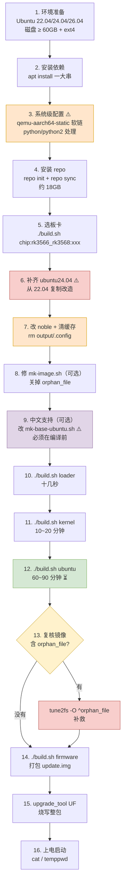

# Ubuntu 26.04 编译鲁班猫2（RK3568）Ubuntu 24.04 镜像完整教程

@[toc](目录)

## 前言

野火官方 SDK 的编译说明只针对 Ubuntu 20.04 / 22.04 宿主机，且 SDK 只带 `ubuntu20.04`、`ubuntu22.04` 两个 rootfs 目录。在新版宿主机上照官方文档走，会在多个环节卡住：包名变更、`qemu-user-static` 被移除、`mkfs.ext4` 默认特性变化等。

本文记录在 **Ubuntu 26.04** 上从零编出 **鲁班猫2（RK3568）Ubuntu 24.04 + XFCE + 6.1 内核** 镜像的全过程，每一步都是实测命令。

**目标成果**：约 4 GB 的 `update.img`（加上中文配置约 5.5 GB），烧录后进入 XFCE 桌面。

| 项目 | 说明 |
| --- | --- |
| 宿主机 | Ubuntu 22.04 / 24.04 / 26.04（本文以 26.04 为例） |
| 目标板卡 | 鲁班猫2（LubanCat-2，RK3568），RK3566 同族可参考 |
| 目标系统 | Ubuntu 24.04 LTS (noble) + XFCE |
| 内核 | 6.1.x |
| SDK | 鲁班猫通用 SDK（`lubancat_linux_generic.xml`） |

---

## 一图看懂全流程

> 下图是完整流程，每步的详细命令见对应章节。



---

## 一、宿主机准备

### 1.1 硬件与磁盘

| 项 | 要求 |
| --- | --- |
| CPU | 8 核以上（rootfs 阶段靠 qemu 模拟 arm64，核心越多越快） |
| 内存 | 8 GB 以上 |
| 磁盘 | **≥ 60 GB 空闲**（`.repo` 约 10 GB + 检出 8 GB + 构建产物 20 GB + 余量） |
| 文件系统 | **必须 ext4**，不能是 NTFS / exFAT / 网络盘 |

确认磁盘类型与空间：

```bash
df -h ~                          # 看剩余空间，至少 60G
findmnt -no FSTYPE -T ~          # 看文件系统类型，必须是 ext4
```

### 1.2 安装依赖

一行装齐（已适配 Ubuntu 26.04 的包名变更）：

```bash
sudo apt update && sudo apt install -y \
  git ssh make gcc g++ libssl-dev device-tree-compiler libfdt1 \
  qemu-user qemu-user-binfmt flex bison bc lz4 m4 expect \
  patchelf chrpath gawk texinfo diffstat live-build fakeroot \
  cmake gcc-multilib g++-multilib unzip libncurses-dev pkgconf \
  python-is-python3 python3 python3-pip python3-pyelftools dpkg-dev \
  rsync cpio debootstrap u-boot-tools 7zip locales \
  libgmp-dev libmpc-dev libelf-dev uuid-dev
```

与官方文档的差异：

| 官方写法 | 26.04 上的问题 | 本文写法 |
| --- | --- | --- |
| `qemu-user-static` | 包已被移除，静态版合并进 `qemu-user` | `qemu-user qemu-user-binfmt` |
| `python` | 无 `python` 命令 | `python-is-python3` |
| `pkg-config` | 新版包名改为 `pkgconf` | `pkgconf` |

各包作用：`device-tree-compiler`/`libfdt1` 编译 dtb；`flex`/`bison` 解析 Kconfig；`lz4` 压缩内核；`live-build`/`debootstrap` 构建 rootfs；`u-boot-tools` 生成 `uboot.img`。

> 不需要手动装交叉编译工具链，SDK 的 `prebuilts/` 里已自带 gcc-arm-10.3。

---

## 二、系统级配置（不做必失败）

官方文档没提这两步，但新版宿主机上不做一定失败。

> `menuconfig` 相关的设置不在本章。它依赖第 3、4 章产出的 `build.sh` 与 defconfig，
> 属于可选项，见 **4.7**。本章只需要装依赖、建软链、建 shim，**不要在这里跑** `menuconfig`。

### 2.1 补 `qemu-aarch64-static` 软链

SDK 脚本里硬编码了 `/usr/bin/qemu-aarch64-static`，而新版 Ubuntu 的 `qemu-user` 只提供 `/usr/bin/qemu-aarch64`（static-pie 格式，不带 `-static` 后缀）：

```bash
sudo ln -sf /usr/bin/qemu-aarch64 /usr/bin/qemu-aarch64-static
ls -l /usr/bin/qemu-aarch64-static     # 确认软链已建立
```

验证 binfmt 已注册（否则 chroot 进 arm64 会报 `Exec format error`）：

```bash
ls /proc/sys/fs/binfmt_misc/ | grep qemu-aarch64
```

无输出时：`sudo systemctl restart systemd-binfmt`。

### 2.2 处理 `python` 与 `python2`

SDK 在**两个不同阶段**分别检查这两个命令，必须分开解决：

| 命令 | 检查位置 | 解法 |
| --- | --- | --- |
| `python` | `check-kernel.sh`（内核） | `apt install python-is-python3` |
| `python2` | `check-loader.sh`（u-boot） | 建 shim 转发到 python3 |

**第一步：解决** `python`

```bash
sudo apt install -y python-is-python3
python -V      # Python 3.x
```

**第二步：解决** `python2`

`check-loader.sh` 全文只做一件事——判断 `which python2` 是否成功，**不检查版本**：

```bash
if ! which python2 >/dev/null; then
	echo "Your python2 is missing for U-Boot"
	exit 1
fi
```

而 rk3568 配置下 Python 2 的功能实际从未被调用：

- u-boot 里 `PYTHON` 变量只用于构建 `pylibfdt`；
- 而 `pylibfdt` 仅在 `CONFIG_PYLIBFDT=y` 时参与编译，实测 rk3568 的 `.config` 里**该选项连定义都没有**，`SPL_OF_PLATDATA` 也显式关闭；
- 编译完 `_libfdt*.so`、`dtoc` 都不存在。

所以让 `which python2` 能成功即可，背后是 Python 3 完全没问题：

```bash
mkdir -p ~/bin

cat > ~/bin/python2 <<'SHIM'
#!/bin/sh
# python2 兼容 shim：SDK 只检查该命令是否存在，
# rk3568 配置下 Python 2 未被真正调用，转发到 python3 即可。
exec python3 "$@"
SHIM

chmod +x ~/bin/python2
echo 'export PATH=$HOME/bin:$PATH' >> ~/.bashrc
source ~/.bashrc

python2 -V      # Python 3.x
which python2   # 非空
```

> 这个 shim 要一直保留，删掉后 `./build.sh loader` 会重新报错。

不推荐装真正的 Python 2：要从源码编译几分钟、2020 年已 EOL、装进 `/usr/local/bin` 容易污染环境。

---

## 三、拉取 SDK

### 3.1 先配 git 身份

`repo init` 末尾要通过 `git var GIT_COMMITTER_IDENT` 读身份，没配就直接失败：

```bash
git config --global user.name  "你的名字"
git config --global user.email "you@example.com"
git var GIT_COMMITTER_IDENT      # 能正常输出即通过
```

### 3.2 初始化与同步

```bash
mkdir -p ~/bin
curl -sSL https://storage.googleapis.com/git-repo-downloads/repo -o ~/bin/repo
chmod a+x ~/bin/repo
echo 'export PATH=$HOME/bin:$PATH' >> ~/.bashrc && source ~/.bashrc

mkdir -p ~/LubanCat_SDK && cd ~/LubanCat_SDK

# repo 本体走清华镜像，如果不行请自行更换其他国内镜像
repo init --depth=1 \
  --repo-url https://mirrors.tuna.tsinghua.edu.cn/git/git-repo --no-repo-verify \
  -u https://github.com/LubanCat/manifests.git \
  -b linux -m lubancat_linux_generic.xml

# 首次运行会问是否启用彩色输出，选 y（只写 ~/.repoconfig）。
```

init 成功的标志：

```
repo has been initialized in /home/<user>/LubanCat_SDK
```

#### 开始同步

约 18 GB，.repo 元数据约 10 GB，检出约 8 GB。中途失败直接重跑同一条命令即可，会自动续传，不用删目录。

```bash
.repo/repo/repo sync -c -j4
```

> `-j4` 是并发数。网络抖动频繁时，调小到 `-j2` 反而更容易一次拉完；带宽充足可加到 `-j8`。

### 3.3 完整性自检

`repo sync` 跑完不代表没缺仓库（单个项目失败会被跳过）。确认 13 个仓库全部检出：

```bash
cd ~/LubanCat_SDK
for p in device/rockchip kernel-5.10 kernel-6.1 u-boot rkbin tools lubancat-bin \
         ubuntu20.04 ubuntu22.04 debian11 debian12 \
         prebuilts/gcc/linux-x86/aarch64/gcc-arm-10.3-2021.07-x86_64-aarch64-none-linux-gnu \
         prebuilts/gcc/linux-x86/arm/gcc-arm-10.3-2021.07-x86_64-arm-none-linux-gnueabihf; do
  [ -e "$p/.git" ] && printf '  OK  %s\n' "$(basename $p)" || printf '  MISSING  %s\n' "$(basename $p)"
done
```

有 `MISSING` 就单独补拉：

```bash
.repo/repo/repo sync -c -j4 --force-sync <仓库目录名>
```

#### 这 13 个仓库都是干什么的（只编 Ubuntu 24.04 也要全拉吗）

`repo sync` 是按 manifest 全量检出的，不能只挑一个。这里说清各自角色，避免以为「拉错了」：

| 仓库 | 是否必需 | 作用 |
| --- | --- | --- |
| `device/rockchip` | **必需** | 板级配置、`build.sh`、分区表、打包脚本，整个编译入口 |
| `u-boot` | **必需** | `MiniLoaderAll.bin` / `uboot.img`，没有就起不来 |
| `rkbin` | **必需** | 瑞芯微闭源 blob（DDR 初始化、trust） |
| `kernel-6.1` | **必需**（本文选 6.1） | 内核 + dtb + 模块 |
| `kernel-5.10` | 可选 | 只有 `KERNEL=5.10` 才用；不编可删，省约 1.8 GB |
| `prebuilts/gcc/...aarch64` | **必需** | 交叉编译器（内核 / u-boot 都靠它） |
| `prebuilts/gcc/...arm` | 必需（同批） | 32 位工具链，部分组件仍要 |
| `tools` | **必需** | `upgrade_tool` 等烧写工具 |
| `lubancat-bin` | **必需** | 预编译 initrd、固件等二进制 |
| `ubuntu22.04` | **必需** | 本文要从它复制出 `ubuntu24.04/`（4.2） |
| `ubuntu20.04` | 可选 | 编 20.04 才用 |
| `debian11` / `debian12` | 可选 | 编 Debian 才用 |

所以「只编 Ubuntu 24.04 却拉了 Debian 仓库」是正常的：manifest 就是这么定义的，`repo sync` 不做子集裁剪。

顺手确认工具链不是空目录：

```bash
prebuilts/gcc/linux-x86/aarch64/gcc-arm-10.3-2021.07-x86_64-aarch64-none-linux-gnu/bin/aarch64-none-linux-gnu-gcc --version
# 应输出 10.3.1
```

---

## 四、选板卡并切到 Ubuntu 24.04

### 4.1 选定 defconfig

```bash
cd ~/LubanCat_SDK
./build.sh chip:rk3566_rk3568:LubanCat_rk3568_ubuntu_xfce_defconfig
```

> 这一步跑不了 `menuconfig`，往后别急着敲。它要 `build.sh`（`repo sync` 生成的软链）和已选定的 defconfig
> 都存在才能启动，属于 4.7 的可选项。

### 4.2 补齐 `ubuntu24.04` 目录

**这是本文最关键的一步：官方 SDK 里没有** `ubuntu24.04/` **目录。** 先确认：

```bash
ls -d ubuntu* debian*
# 实际输出只有：ubuntu20.04  ubuntu22.04
```

而 `mk-rootfs.sh` 会执行 `cd "$RK_UBUNTU_NUMBER"`，选了 noble 就是 `cd ubuntu24.04`
→ 目录不存在 → 整个 rootfs 构建在这一行断掉。所以必须自己补齐。

从 `ubuntu22.04` 复制时**必须排除大件产物**（`binary/`、`.tar.gz`、`.img` 合计约 8 GB）：

```bash
cd ~/LubanCat_SDK
rsync -a \
  --exclude 'binary' \
  --exclude '*.tar.gz' \
  --exclude '*.img' \
  ubuntu22.04/ ubuntu24.04/

du -sh ubuntu24.04        # 期望约 370 MB
```

### 4.3 改造三处

**①** `sources.list` **换 noble**

```bash
cd ~/LubanCat_SDK/ubuntu24.04
sed -i 's/\bjammy\b/noble/g' sources.list
grep -c noble sources.list        # 期望 8（4 条 deb + 4 条注释的 deb-src）
```

**②** `mk-base-ubuntu.sh` **改基础包版本号**

```bash
sed -i -e 's|ubuntu-base-22\.04\.5-base-|ubuntu-base-24.04.5-base-|g' \
       -e 's|releases/22\.04/release|releases/24.04/release|g' mk-base-ubuntu.sh
grep -c 'ubuntu-base-24.04' mk-base-ubuntu.sh     # 期望 4
```

> ⚠️ 两条替换**必须写成两个** `-e`，不要用单引号内换行续写的写法。单引号里的 `\` + 换行会被 `sed` 当成正则的一部分，报 `sed: -e 表达式 #1: 未终止的地址正则表达式`。

顺手确认下载地址真实可用（避免跑到下载那步才发现 404）：

```bash
curl -sI http://cdimage.ubuntu.com/ubuntu-base/releases/24.04/release/ubuntu-base-24.04.5-base-arm64.tar.gz | head -1
# 期望：HTTP/1.1 200 OK
```

**③ 检查脚本语法**

```bash
for f in mk-base-ubuntu.sh mk-image.sh mk-ubuntu-rootfs.sh; do bash -n $f && echo "$f OK"; done
```

### 4.4 把 defconfig 切到 noble

`FOCAL / JAMMY / NOBLE` 是 **choice 类型，同一时间只能有一个为** `y`，所以必须先关掉其他两个：

```bash
cd ~/LubanCat_SDK
CFG=device/rockchip/.chips/rk3566_rk3568/LubanCat_rk3568_ubuntu_xfce_defconfig
cp --update=none "$CFG" "${CFG}.bak"
# cp -n $CFG ${CFG}.bak

sed -i -E 's/^RK_UBUNTU_(FOCAL|JAMMY|NOBLE)=y/# RK_UBUNTU_\1 is not set/' $CFG
sed -i '1i RK_UBUNTU_NOBLE=y' $CFG

grep -cE '^RK_UBUNTU_(FOCAL|JAMMY|NOBLE)=y' $CFG     # 期望 1
```

也可以用交互菜单（`System configuration -> Rootfs -> Ubuntu -> distro`），但脚本化改文件更可靠。

### 4.5 清掉 `output/.config` 缓存

**这一步最容易漏，也最致命。** `mk-config.sh` 靠文件时间戳判断是否需要重新生成配置，用 `sed` 改文件后判断不可靠，编译时用的还是旧配置——那么你辛苦补的 `ubuntu24.04/` 根本不会被用到，编出来仍是 22.04 的内容。

```bash
cd ~/LubanCat_SDK
rm -f output/.config output/.config.old
./build.sh defconfig:LubanCat_rk3568_ubuntu_xfce_defconfig

grep -E 'RK_UBUNTU_(VERSION|NUMBER|FOCAL|JAMMY|NOBLE)' output/.config
```

期望：

```
RK_UBUNTU_VERSION="noble"
RK_UBUNTU_NUMBER="ubuntu24.04"
# RK_UBUNTU_FOCAL is not set
# RK_UBUNTU_JAMMY is not set
RK_UBUNTU_NOBLE=y
```

> 注意 `FOCAL` 那行可能整个消失，这是正常的：`savedefconfig` 只保留非默认值，choice 的默认项不写出来。所以别去数总行数，只看 `RK_UBUNTU_NOBLE=y` 在不在、是不是唯一的 `=y`。

### 4.6 编译前一键总检查

前面都是分步做的，容易漏。跑这段一次验证「配置 + 目录 + 脚本」三件套：

```bash
cd ~/LubanCat_SDK

VER=$(grep -oP '(?<=RK_UBUNTU_VERSION=")[^"]+' output/.config 2>/dev/null)
NUM=$(grep -oP '(?<=RK_UBUNTU_NUMBER=")[^"]+'  output/.config 2>/dev/null)
CH=$(grep -cE '^RK_UBUNTU_(FOCAL|JAMMY|NOBLE)=y' output/.config 2>/dev/null)
NBL=$(grep -c '^RK_UBUNTU_NOBLE=y' output/.config 2>/dev/null)

rc=0
[ "$VER" = "noble" ]      || { echo "❌ VERSION 不是 noble";              rc=1; }
[ "$NUM" = "ubuntu24.04" ] || { echo "❌ NUMBER 不是 ubuntu24.04";        rc=1; }
[ "${CH:-0}" = 1 ]        || { echo "❌ choice 数量异常（$CH）";          rc=1; }
[ "${NBL:-0}" = 1 ]       || { echo "❌ RK_UBUNTU_NOBLE=y 不在或重复";     rc=1; }
[ -d "${NUM:-none}" ]     || { echo "❌ 目录 $NUM 不存在，回 4.2";         rc=1; }
grep -q 'ubuntu-base-24\.04' "$NUM/mk-base-ubuntu.sh" 2>/dev/null \
  || { echo "❌ mk-base-ubuntu.sh 版本号没改成 24.04";                    rc=1; }
grep -q 'noble' "$NUM/sources.list" 2>/dev/null \
  || { echo "❌ sources.list 里没有 noble";                              rc=1; }
for f in mk-base-ubuntu.sh mk-image.sh mk-ubuntu-rootfs.sh ch-mount.sh; do
  [ -f "$NUM/$f" ] || continue
  bash -n "$NUM/$f" 2>/dev/null || { echo "❌ $f 语法有误"; rc=1; }
done

[ $rc = 0 ] && echo "✅ 全部就绪，可以开始编译" || echo "⚠️ 上面有未通过项，先修好"
```

花 10 秒跑这段，能省掉一小时白等。

### 4.7 可选：进 `menuconfig` 交互改配置

**只有想临时改配置又不写回 defconfig 时才用**，直改 `defconfig` 文件（4.4 那种做法）更稳。
此时 `build.sh`、`device/rockchip/`、defconfig 都已就位，才能启动：

```bash
cd ~/LubanCat_SDK
HOST_EXTRACFLAGS="-Wno-implicit-int" ./build.sh menuconfig
```

想长期生效就写进 `~/.bashrc`（只影响宿主机侧编译工具，不会进镜像）：

```bash
echo 'export HOST_EXTRACFLAGS="-Wno-implicit-int"' >> ~/.bashrc
```

> 这里前缀 `HOST_EXTRACFLAGS` 是为了绕开 GCC 15 的一个报错。若仍报
> `Unable to find the ncurses libraries` 或 `Your display is too small to run Menuconfig!`，
> 原因见 **9.2**。
>
> 改完记得回 4.5 清缓存重新生成 `output/.config`，否则改动不生效。

---

---

## 五、把中文编译进镜像（可选）

> **本章是可选的。** 只想要英文界面就整章跳过，直接从第六章开始编译——不影响其他任何步骤。
>
> 但**位置是固定的**：本章改的是 `ubuntu24.04/mk-base-ubuntu.sh`，而它是 `./build.sh ubuntu` 的输入。
> 想用中文界面就必须在编译前改完；编完再改，只能删产物重编，白等 60~90 分钟。

### 5.1 为什么默认是英文

SDK 里的中文化代码存在，但**被锁在** `xfce-full` **条件里**，而默认用的是 `xfce`。更隐蔽的是第二层：官方 `ubuntu-base` 镜像自带一个 dpkg 配置，把所有翻译在安装时直接丢弃：

```bash
# ubuntu24.04/binary/etc/dpkg/dpkg.cfg.d/excludes（来自 ubuntu-base 官方包）
# Drop all translations
path-exclude=/usr/share/locale/*/LC_MESSAGES/*.mo
```

实测你的镜像：`zh_CN/LC_MESSAGES/` 是**空目录**，全 rootfs 只剩 45 个 `.mo`，且全是 `coreutils` 的 `LC_TIME`（日期格式，不是界面翻译）。

而 Xfce 的翻译恰好就在被排除的路径下：

```bash
$ dpkg -c thunar-data_*.deb | grep zh_CN
./usr/share/locale/zh_CN/LC_MESSAGES/thunar.mo    # ← 被 path-exclude 吃掉
```

所以 `language-pack-zh-hans` **救不了 Xfce 界面**——它只提供 `/usr/share/locale-langpack/` 下的系统工具翻译（apt、bash、PAM），不含 thunar / xfce4-session / xfwm4 / xfdesktop。

三层原因汇总：

| 层 | 问题 | 后果 |
| --- | --- | --- |
| 1 | 中文化代码只在 `xfce-full` 分支 | `xfce` 目标完全不装语言包 |
| 2 | `dpkg.cfg.d/excludes` 的 `path-exclude` | 即使装了，所有 `.mo` 被丢弃 |
| 3 | 无 `/etc/default/locale` 的 `LANG` | 不生成 zh_CN locale |

三层缺一不可，但**没有固定的先后依赖**：第 1 层决定「装不装」，第 2 层决定「装下来的 `.mo` 留不留」。

真正要注意的是**时序**，而不是层级顺序：`path-exclude` 位于 `binary/etc/dpkg/dpkg.cfg.d/excludes`，
解压 base 包时就已存在，必须在 chroot 内 `apt-get -y update` **之前**改掉。
`apt` 一旦开始装包，被排除的 `.mo` 就直接不落地，事后再改配置只能重装。

### 5.2 改脚本

> **下面 5 处改动都是我们加的，SDK 原版没有。** 原版把整套中文化关在 `xfce-full` 条件里，  
> 而 Kconfig 只暴露 `xfce`，所以**原版用** `xfce` **编出来必然全英文**。

改 `ubuntu24.04/mk-base-ubuntu.sh`，先备份：

```bash
cd ~/LubanCat_SDK/ubuntu24.04
cp mk-base-ubuntu.sh /tmp/mk-base-ubuntu.sh.bak
```

#### 一次性改完

三个会让构建失败或静默失效的写法：

| 问题 | 后果 |
| --- | --- |
| `apt purge ibus firefox` 无容错 | `xfce` 下 firefox 本就没装，`bash -e` 返回 100，**构建立刻终止** |
| `$(check-language-support)` 在宿主机展开 | chroot 外层执行，宿主机无此工具 → 展开为空，**等于没装语言包** |
| `/etc/environment` 写 `LC_ALL` | 被所有进程继承，未适配程序会 fallback 成乱码 |

相对上游 `HEAD`，与中文化相关的改动共 5 处，下面脚本把上表 5 处一次改完：

```bash
cd ~/LubanCat_SDK/ubuntu24.04
python3 - <<'EOF'
p = "mk-base-ubuntu.sh"
s = open(p, encoding="utf-8").read()

# 1) 解除 dpkg 对翻译的排除（必须在 apt-get update 之前）
#    注意：这条 sed 由脚本在 chroot 内执行，不要直接在宿主机终端跑
#    （宿主机 /etc/dpkg/dpkg.cfg.d/excludes 不存在，会报「没有那个文件或目录」）
anchor = "apt-get -y update\n"
inject = ("# 解除 dpkg 对翻译文件的排除（必须早于下面所有 apt 安装）\n"
          "sed -i 's|^path-exclude=/usr/share/locale/\\*/LC_MESSAGES/\\*.mo|# &|' "
          "/etc/dpkg/dpkg.cfg.d/excludes\n\n")
assert s.count(anchor) == 1
s = s.replace(anchor, inject + anchor)

# 2) 两处中文化条件都加上 xfce
#    原版这几步本来就在脚本里，只是被 xfce-full 条件挡住，放开后自动生效：
#      sed -i 's/^# *\(zh_CN.UTF-8\)/\1/' /etc/locale.gen   # 启用 locale 模板
#      echo "LANG=zh_CN.UTF-8" >> /etc/default/locale
#      locale-gen zh_CN.UTF-8                                # 真正生成 locale
#      echo "LANG=zh_CN.UTF-8" >> /etc/environment
#      echo "export LANG/LANGUAGE=..." >> /etc/profile.d/zh_CN.sh
#    locale-gen 是必须的：没有它 /usr/lib/locale/zh_CN.utf8 不存在，
#    翻译文件再全程序也会 fallback 回英文。
#    （以上均在 chroot 内执行，不要在宿主机终端直接跑）
old_cond = 'if [[ "$TARGET" == "gnome-full" ||  "$TARGET" == "xfce-full" ]]; then'
new_cond = 'if [[ "$TARGET" == "xfce" || "$TARGET" == "gnome-full" || "$TARGET" == "xfce-full" ]]; then'
assert s.count(old_cond) == 2
s = s.replace(old_cond, new_cond)

# 3) purge 容错（bash -e 下 purge 不存在的包会终止构建）
old_purge = "    apt purge ibus firefox -y\n"
assert s.count(old_purge) == 1
s = s.replace(old_purge,
    "    # xubuntu 默认不装 firefox，purge 不存在的包会返回 100，必须容错\n"
    "    apt purge -y ibus firefox || true\n")

# 4) fcitx4 → fcitx5（可选优化，不是必须）
#    noble 仓库里 fcitx 1:4.2.9.9-2build2 及其 table/pinyin/googlepinyin/config-gtk
#    全都存在，fcitx4 并未废弃，只是不再是默认选择。
#    换 fcitx5 的理由：上游主推、X11/Wayland 双支持更好。想省事可以整段跳过。
old_fcitx = r"\${APT_INSTALL} fcitx fcitx-table fcitx-googlepinyin fcitx-pinyin fcitx-config-gtk"
if old_fcitx in s:
    s = s.replace(old_fcitx,
        r"\${APT_INSTALL} fcitx5 fcitx5-chinese-addons fcitx5-frontend-gtk3 "
        r"fcitx5-frontend-qt5 fcitx5-config-qt im-config")
    # 原写法直接改 xinputrc，改由 im-config 接管
    s = s.replace("sed -i 's/default/fcitx/g' /etc/X11/xinit/xinputrc",
                  "im-config -n fcitx5")

# 5) $(check-language-support) 在宿主机展开恒为空，改显式包名
old_cls = r"\${APT_INSTALL} $(check-language-support)"
assert s.count(old_cls) == 1
s = s.replace(old_cls, r"\${APT_INSTALL} fonts-wqy-microhei fonts-wqy-zenhei" + "\n"
                      r"    \${APT_INSTALL} language-pack-zh-hans-base")

# 6) 去掉 /etc/environment 里的 LC_ALL（反模式）
#    注意：只删 /etc/environment 这一处，/etc/profile.d/zh_CN.sh 里的保留
s = s.replace('    echo "LC_ALL=zh_CN.UTF-8" >> /etc/environment    \n', "")

open(p, "w", encoding="utf-8").write(s)
print("✅ 已改造中文化块")
EOF

bash -n mk-base-ubuntu.sh && echo "✅ 语法通过"
```

> `im-config -n fcitx5` 以 root 运行，写的是系统级 `/etc/X11/xinit/xinputrc`，所有用户生效。
>
> **第 4 步（fcitx4 → fcitx5）是可选优化，不是修复。** 实测 noble 仓库里
> `fcitx 1:4.2.9.9-2build2`、`fcitx-table`、`fcitx-pinyin`、`fcitx-config-gtk`、`fcitx-googlepinyin`
> 全部可装，SDK 原来的 fcitx4 写法在 24.04 上**能正常构建**。想省事就把第 4 步整段删掉，
> 其余五步照做即可。

### 5.3 删产物重新编译(首次编译可跳过)

```bash
cd ~/LubanCat_SDK
rm -f ubuntu24.04/ubuntu-rk356x-xfce-rootfs.img
rm -f ubuntu24.04/ubuntu-base-xfce-arm64-*.tar.gz   # 必须删，中文化改动在这里面

sudo -v
./build.sh ubuntu        # 60~90 分钟
./build.sh firmware
```

### 5.4 编完先验证再烧录(首次编译可跳过)

```bash
cd ~/LubanCat_SDK/ubuntu24.04

echo "=== 1. 中文翻译已进镜像（之前是 0）==="
find binary/usr/share/locale/zh_CN/LC_MESSAGES -name "*.mo" | wc -l
ls binary/usr/share/locale/zh_CN/LC_MESSAGES/thunar.mo && echo "✅ Thunar 有中文"

echo "=== 2. locale 已生成 ==="
ls binary/usr/lib/locale/zh_CN.utf8 && echo "✅ locale OK"
cat binary/etc/default/locale

echo "=== 3. 输入法 ==="
ls binary/usr/bin/fcitx5 && echo "✅ fcitx5 已装"
grep -v '^#' binary/etc/X11/xinit/xinputrc | grep -v '^$'   # 期望 run_im fcitx5
```

> 若跳过了「fcitx4 → fcitx5」那步，第 3 项改成 `ls binary/usr/bin/fcitx`（期望 `run_im fcitx`）。

三项全过再烧录。

---

## 六、编译

### 6.1 分步编译

分步的好处是哪一步失败只看那一步的日志，不用重来。

```bash
cd ~/LubanCat_SDK
export PATH=$HOME/bin:$PATH      # 让 python2 shim 生效

./build.sh loader                # u-boot + trust + MiniLoaderAll.bin
./build.sh kernel                # 6.1 内核 + dtb + extboot.img

# 关键：提前认证，见 6.3
echo "$USER ALL=(ALL) NOPASSWD: ALL" | sudo tee /etc/sudoers.d/99-build >/dev/null
sudo chmod 0440 /etc/sudoers.d/99-build
sudo visudo -c
# 编译 rootfs
./build.sh ubuntu
# 编译完撤销权限
sudo rm -f /etc/sudoers.d/99-build

# 打包 update.img
./build.sh firmware
```

### 6.2 耗时参考

8 核以上 x86_64 + SSD：

| 命令 | 产物 | 耗时 |
| --- | --- | --- |
| `./build.sh loader` | `rk356x_spl_loader_*.bin`、`uboot.img` | 十几秒 |
| `./build.sh kernel` | `Image`、`dtb`、`extboot.img` | 10~20 分钟 |
| `./build.sh ubuntu` | `ubuntu-rk356x-xfce-rootfs.img` | **60~90 分钟** |
| `./build.sh firmware` | `update.img` | 半分钟 |

rootfs 慢的原因是：要在 chroot 里通过 apt 装上千个 deb（XFCE 桌面全套），且全程用 qemu 模拟 arm64，CPU 开销极大。

### 6.3 关于 sudo

`sudo -v` **不是可选项。** `./build.sh ubuntu` 内部要执行 `sudo mount`、`sudo chroot`、`sudo mkfs.ext4`，而 `mk-base-ubuntu.sh` 结尾打包前会 `sudo umount`。如果那时密码提示超时，**卸载会静默失败**，接着 `tar` 就把宿主机的 `/proc` 打进包里，生成一个**看起来成功但完全不能用**的废包（详见 9.3）。

```bash
cd ~/LubanCat_SDK
sudo -v              # 提前认证，凭证缓存约 15 分钟
sudo ./build.sh ubuntu
```

编译在 60~90 分钟，可能超过缓存时长。可以在另一个终端定时续期，或临时开免密（用完必须删）：

```bash
echo "$USER ALL=(ALL) NOPASSWD: ALL" | sudo tee /etc/sudoers.d/99-build >/dev/null
sudo chmod 0440 /etc/sudoers.d/99-build
sudo visudo -c       # 必须校验语法，否则可能把 sudo 锁死
# ... 编译 ...
sudo rm -f /etc/sudoers.d/99-build # 编译完撤销权限
```

### 6.4 编完立刻校验 ext4 特性

宿主机 `e2fsprogs ≥ 1.47` 的 `mkfs.ext4` 默认会开启 `orphan_file` 特性。Ubuntu 22.04 目标系统的 `e2fsck` 只有 1.46.5，不认识它，会卡在 initramfs。**24.04 目标系统自带 1.47.0，认识这个特性，所以本文方案不受影响**，但校验一下成本极低：

```bash
cd ~/LubanCat_SDK
IMG=ubuntu24.04/ubuntu-rk356x-xfce-rootfs.img

if dumpe2fs -h $IMG 2>/dev/null | grep -q orphan_file; then
  echo "检测到 orphan_file（罕见），移除并重打固件"
  sudo tune2fs -O ^orphan_file $IMG
  ./build.sh firmware
else
  echo "✅ 无 orphan_file"
fi
```

**24.04 目标系统不需要改这一处**，因为它的 `e2fsck` 是 1.47.0，本身就认识 `orphan_file`。上面那段是保底措施：万一校验发现它有，`tune2fs` 直接移除即可，不用重编。

官方 SDK 的 `mk-image.sh` 原文是这样（**没有**任何 `-O` 参数，会用上宿主机的全部默认特性）：

```bash
# ubuntu24.04/mk-image.sh（官方原版）
IMAGE_SIZE_MB=$(( $(sudo du --apparent-size -sm ${TARGET_ROOTFS_DIR} | cut -f1) + ... ))
IMAGE_SIZE_MB=$(( $IMAGE_SIZE_MB * 110 / 100 ))

sudo mkfs.ext4 -d ${TARGET_ROOTFS_DIR} ${ROOTFSIMAGE} ${IMAGE_SIZE_MB}M
```

如果你想让 22.04 / 24.04 共用一套脚本、或者想从源头就规避这个特性，可以把最后一行改成：

```bash
sed -i 's|^sudo mkfs.ext4 -d|MKFS_OPTS="-O ^orphan_file"

sudo mkfs.ext4 ${MKFS_OPTS} -d|' ubuntu24.04/mk-image.sh
grep -n "MKFS_OPTS" ubuntu24.04/mk-image.sh    # 确认已插入
bash -n ubuntu24.04/mk-image.sh                # 确认语法
```

### 6.5 只想重做 rootfs(首次编译可跳过)

脚本靠文件是否存在决定是否跳过。改过 `mk-base-ubuntu.sh` 时**两个都要删**：

```bash
rm -f ubuntu24.04/ubuntu-rk356x-xfce-rootfs.img
rm -f ubuntu24.04/ubuntu-base-xfce-arm64-*.tar.gz   # 改过 mk-base-ubuntu.sh 才需要删
./build.sh ubuntu && ./build.sh firmware
```

> 只删 `rootfs.img` 不够：`mk-rootfs.sh` 里是
> `if [ ! -f ubuntu-base-*.tar.gz ]; then ./mk-base-ubuntu.sh; fi`，
> tar 包在就永远不会重跑这个脚本。

---

---

## 七、烧录

### 7.1 产物位置

`output/firmware/` 下**全是软链**，真实文件在各自仓库目录：

```
output/firmware/update.img        -> output/update/Image/update.img
output/firmware/MiniLoaderAll.bin -> u-boot/rk356x_spl_loader_v*.bin
output/firmware/uboot.img         -> u-boot/uboot.img
output/firmware/boot.img          -> kernel-6.1/extboot.img
output/firmware/rootfs.img        -> ubuntu24.04/ubuntu-rk356x-xfce-rootfs.img
output/log/latest/                <- 最近一次构建日志
```

因为都是软链，看大小要加 `-L`：

```bash
ls -lh  output/firmware/update.img     # 几十字节（软链自身）
ls -lhL output/firmware/update.img     # 真实大小
du -shL output/firmware/*              # 真实占用
```

> `du -sh` 显示 `0` 是正常的，不是文件坏了——ext4 会把 60 字节以内的软链目标直接内联进 inode，不占数据块。

### 7.2 烧录前验证镜像

不烧录也能确认内容对不对：

```bash
cd ~/LubanCat_SDK
mkdir -p /tmp/chk
sudo mount -o loop,ro ubuntu24.04/ubuntu-rk356x-xfce-rootfs.img /tmp/chk

cat /tmp/chk/etc/os-release                 # 应为 Ubuntu 24.04.x LTS
grep -E "^(cat|root):" /tmp/chk/etc/passwd  # 确认用户存在
ls /tmp/chk/lib/modules/                    # 应为 6.1.x-rk356x

sudo umount /tmp/chk
```

**内核版本和模块目录版本必须一致**，不一致会缺驱动。

### 7.3 用 `upgrade_tool`烧录

网上很多教程写 `rkdeveloptool ul update.img`，**这是错的**：

- `rkdeveloptool` 的 `ul` 是 **UpgradeLoader**，只把 loader 写进设备（几百 KB），**不解析** `update.img` 里的内核和 rootfs；
- `db` 是 DownloadBoot，只是把 bootloader 下载到内存；
- apt 源里那个是 pine64 分支，根本没有烧整包的命令，`uf` 会报 `command is invalid!`。

烧录使用 SDK 自带工具，无需安装：

```bash
TOOL=~/LubanCat_SDK/tools/linux/Linux_Upgrade_Tool/Linux_Upgrade_Tool/upgrade_tool
FW=~/LubanCat_SDK/output/firmware

# 1) 板子按住 MASKROM 键上电，确认识别
sudo $TOOL LD
#   DevNo=1 Vid=0x2207,Pid=0x350a ... Mode=Maskrom

# 2) 可选：只读解析固件，确认芯片型号和包完整性
sudo $TOOL SFI $FW/update.img
# SFI 输出里 Chip Tag 必须是 3568：
# Type:Update Firmware
# Chip Tag:3568   Version:1.0.00   Sign:false
# Entry Count:6
#     EntryNo=3 ; file=uboot.img;  partition=uboot;  size=0x800000
#     EntryNo=4 ; file=boot.img;   partition=boot;   size=0x8000000
#     EntryNo=5 ; file=rootfs.img; partition=rootfs

# 3) 烧写整包（依次写入 loader、uboot、boot、rootfs）
sudo $TOOL UF $FW/update.img
# 不想烧完自动重启
sudo $TOOL UF $FW/update.img -noreset
```

常用命令：

| 命令 | 作用 |
| --- | --- |
| `LD` | 列出已连接设备 |
| `UF <firmware> [-noreset]` | **烧写整包**（最常用） |
| `PL` | 列出分区表 |
| `SFI <firmware>` | 只读解析固件信息 |
| `UL <loader>` | 只更新 loader |
| `RD` | 重启设备 |

SD 卡启动：

```bash
lsblk        # 先确认卡设备名，千万别写错盘
sudo dd if=$FW/update.img of=/dev/sdX bs=4M conv=fsync status=progress
```

---

---

## 八、首次登录

| 用户 | 密码 | 说明 |
| --- | --- | --- |
| `cat` | `temppwd` | 普通用户，在 sudo 组 |
| `root` | `root` | 已配置为串口可登录 |

调试串口：**波特率 1500000，8N1**。

首次启动会自动把 rootfs 扩展到整块存储的剩余空间，稍等片刻。

---

---

## 九、踩坑汇总

按执行顺序排列，对照报错直接查。

### 9.1 拉取 SDK 阶段

| 报错                                                                   | 原因                                                                                  | 解法                                                                         |
| -------------------------------------------------------------------- | ----------------------------------------------------------------------------------- | -------------------------------------------------------------------------- |
| `GitCommandError: 'var GIT_COMMITTER_IDENT' failed`                  | git 全局身份未配置                                                                         | 见 3.1                                                                      |
| `GnuTLS recv error (-110)`                                           | GitHub 的 git 通道被 RST                                                                | 见下方调优                                                                      |
| `Cannot get .../git-repo/clone.bundle`                               | 缺 `--repo-url`                                                                      | 加上镜像地址（见 3.2）                                                              |
| 拉 repo 本体 404                                                        | 该路径下已无内容（实测 `404`）                                                                  | `--repo-url` 换清华源等国内源。**别直接写** `gerrit.googlesource.com`**，国内多数网络 443 不通** |
| `-u` 指向 github 时卡住                                                   | `github.com` 直连抖动（实测偶发 20 s 无响应）                                                    | 换网络/代理后重试                                                                  |
| `repo sync` 拉子仓库极慢或中断                                                | 13 个子仓库直连 `github.com`，链路抖动                                                         | 直接重跑（断点续传）；调小 `-j` 减少并发；**有需要**配 `insteadOf` 中转                            |
| `Cannot initialize work tree` / `不是 Git 仓库：'.repo/projects/xxx.git'` | `.repo/project-objects/` 里留了空壳目录（只有 `objects/`，没有 `config`/`HEAD`），git 不认、repo 又不重建 | 两处目录一起删再 sync                                                              |
| `Repo command failed: UpdateManifestError`                           | 清单半成品损坏                                                                             | `rm -rf ~/LubanCat_SDK/.repo/manifests*` 后重跑 init                          |
| `Current user is not the owner of SDK source`                        | 之前用 root 跑过                                                                         | `sudo chown -h -R $USER:$USER ~/LubanCat_SDK`                              |

网络被 RST 时先做调优再重试：

```bash
git config --global http.postBuffer 524288000
git config --global http.lowSpeedLimit 0
git config --global http.lowSpeedTime 999999
git config --global http.version HTTP/1.1
```

调完**直接重跑** `repo sync` 就行，已下载的对象会续传。

> ⚠️ 不要随手 `rm -rf .repo`：那会丢掉已下好的十几 GB，并把问题变成「从零再拉一遍」。
> 只有报 `UpdateManifestError`（清单确实坏了）时才删 `.repo/manifests*`，其余情况一律续传。

### 9.2 编译阶段

| 报错 | 原因 | 解法 |
| --- | --- | --- |
| `Please move SDK source code into an ext4 partition` | SDK 在 NTFS/exFAT/网络盘 | 挪到 ext4（见 1.1） |
| `Your python2 is missing for U-Boot` | 只检查命令存在 | 建 shim（见 2.2） |
| `Unable to find the ncurses libraries` | GCC 15 的 C23 默认 | `HOST_EXTRACFLAGS="-Wno-implicit-int"`（见 4.7） |
| `Your display is too small to run Menuconfig!` | 终端不足 19 行 × 80 列 | 拉高终端，或跳过 menuconfig 直接改文件 |
| `ERROR: No 'dtc'` | 缺 device-tree-compiler | `apt install device-tree-compiler` |
| `fdtget: libfdt.so.1: cannot open` | 运行库是独立包 | `apt install libfdt1` |
| `flex: not found` / `bison: not found` | Kconfig 解析需要 | `apt install flex bison` |
| `lz4: command not found` | 内核压缩需要 | `apt install lz4` |
| `mkfs.ext4: invalid option -- 'd'` | e2fsprogs 太老（< 1.43） | `apt install --only-upgrade e2fsprogs` |
| `chroot: ... Exec format error` | binfmt 未注册 | `sudo systemctl restart systemd-binfmt` |
| `cd: ubuntu24.04: No such file or directory` | SDK 没这个目录 | 从 22.04 复制（见 4.2） |
| `error: rootfs.img's size exceed ... size limit!` | rootfs 超分区限制 | `./build.sh mod-parts` 调大，或改 lite 版 |
| `sudo: A terminal is required to authenticate` | 无 TTY | 在真实终端跑，或临时开免密（见 6.3） |
| `rsync`/`cp -a` 刷大量「权限不够」 | `binary/` 是 root 属主 | 用 `rsync --exclude binary`（见 4.2） |

`Unable to find the ncurses libraries` **展开说明（GCC 15 专属）**

这条报错是**误导性的**，`libncurses-dev` 其实装着。真正原因是
`kconfig/lxdialog/check-lxdialog.sh` 用这段代码测试 ncurses 能否链接：

```c
#include CURSES_LOC
main() {}
```

`main()` 没有返回类型，是 K&R 写法。GCC 14 及以前只是 `-Wimplicit-int` 警告，
**GCC 15 把默认方言切到 C23 后升级成错误**。脚本只要发现编译失败，就一律报「找不到 ncurses」，
所以报错内容和根因完全对不上。

先确认自己的 GCC 版本：

```bash
gcc --version | head -1     # 15.x 会踩，13.x/14.x 不踩
```

修法见 **4.7**：`HOST_EXTRACFLAGS="-Wno-implicit-int"` 覆盖编译参数，不改 SDK 源码。

另外 `Your display is too small to run Menuconfig!` 跟配置无关，是 ncurses 的硬性检查：
终端窗口**至少 19 行 × 80 列**，否则 menuconfig 进界面之前就退出。

### 9.3 两个同根因的致命问题：残留挂载

两者根因相同（`umount` 没成功），只是暴露时机不同：

| | 开头就失败 | 结尾静默失败 |
| --- | --- | --- |
| 残留挂载来自 | 上一轮失败留下的 | 本轮 `sudo umount` 因密码超时失败 |
| 报错位置 | 开头 `rm -rf binary` | 结尾 `tar` 打包 |
| 报错特征 | 上千行 `Operation not permitted` | **仅 4 行** `Cannot open: Permission denied` |
| 危害 | 编译直接失败 | **静默生成废包，白等几十分钟** |

**开头就失败的现象：**

```
rm: cannot remove 'binary/sys/module/cfg80211/...': Operation not permitted
ERROR: exit code 1 from line 259
```

**结尾静默失败的现象：**

```
[sudo: authenticate] Password:
sudo: timed out                      ← 关键：卸载失败了
Run tar pack ubuntu-base-xfce-arm64-*.tar.gz
tar: binary/proc/sys/vm/drop_caches: Cannot open: Permission denied
```

只有 4 行，看起来像无关紧要的小问题，**实际上整台宿主机的** `/proc` **正在被打进包里**。

**为什么会产生残留**：`ch-mount.sh` 挂的是三个内核虚拟文件系统（`proc`/`sys`/`dev`），卸载只挂在 `trap finish ERR` 上。只要中途失败、Ctrl-C、或终端断开，卸载就来不及执行。下次 `rm -rf binary` 就删不掉这些挂载点——它们是宿主机内核的映射，不是普通文件。

**确认：**

```bash
grep LubanCat_SDK /proc/mounts        # 有输出就是残留
pgrep -af "tar zcf ubuntu-base"       # 中招时能看到 tar 还在跑
```

**还可以查包里有没有** `proc/`（正常应为 0，实测中招时是 2346）：

```bash
cd ~/LubanCat_SDK/ubuntu24.04
tar -tzf ubuntu-base-*-*.tar.gz | grep -c "^binary/proc/"
```

**修复：**

```bash
# 先杀掉 tar（root 进程，必须 sudo）
sudo pkill -9 -f "tar zcf ubuntu-base-xfce"

# 三个都要卸，只卸 proc 不够
sudo umount -l ~/LubanCat_SDK/ubuntu24.04/binary/proc
sudo umount -l ~/LubanCat_SDK/ubuntu24.04/binary/sys
sudo umount -l ~/LubanCat_SDK/ubuntu24.04/binary/dev
grep ubuntu24.04/binary /proc/mounts        # 应为空

# 还要删废包
rm -f ~/LubanCat_SDK/ubuntu24.04/ubuntu-base-xfce-arm64-*.tar.gz
```

清理后直接重跑，**不需要删除整个** `binary/` **目录**（误删了也不要紧，脚本会重新解压 base 包重建，只是多花几分钟）。

`umount` 报 `target is busy` 时先 `-l`（懒卸载），还不行加 `-f`，仍残留用 `-l -R` 递归。

**避免**：跑 rootfs 前先 `sudo -v`；不要用 Ctrl-C 中断 rootfs；建议 `tmux` 或 `nohup` 防断线。

### 9.4 烧录与启动阶段

| 现象                                                         | 原因                              | 解法                                                                          |
| ---------------------------------------------------------- | ------------------------------- | --------------------------------------------------------------------------- |
| `rkdeveloptool` 报 `command is invalid!`                    | 该分支没有烧整包命令                      | 改用 `upgrade_tool UF`（见 7.3）                                                 |
| 上电卡在 `(initramfs)`，报 `unsupported feature(s): FEATURE_C12` | 目标系统 `e2fsck` 不认识 `orphan_file` | 见 6.4。**已进 initramfs 后** `fsck.ext4 -y` **救不了**，只能修镜像重烧                     |
| 桌面黑屏只有鼠标指针                                                 | 多为 Mali 库与内核版本不匹配               | ① 先用 lite 版验证基础显示；② 确认 `/lib/modules/` 目录名与内核版本一致；③ 检查 GPU 驱动与 `libmali` 版本 |

### 9.5 常见操作问答

**想改内核配置或设备树**

```bash
./build.sh kconfig      # 等价于 make menuconfig
./build.sh kernel
./build.sh firmware
```

**想节省磁盘**

`./build.sh cleanall` 清理 `output/`。`kernel-5.10/` 确定不用可直接删，省约 1.8 GB。

**编译完想确认内核与 rootfs 版本匹配**

```bash
cd ~/LubanCat_SDK
dumpe2fs -h ubuntu24.04/ubuntu-rk356x-xfce-rootfs.img 2>/dev/null | head -5
sudo mount -o loop,ro ubuntu24.04/ubuntu-rk356x-xfce-rootfs.img /tmp/chk
ls /tmp/chk/lib/modules/          # 应与内核版本一致
sudo umount /tmp/chk
```

**rootfs 阶段下载慢**

换清华源（或改用更快的镜像）：

```bash
sed -i 's#mirrors.aliyun.com#mirrors.tuna.tsinghua.edu.cn#g' ubuntu24.04/sources.list
```

基础包可手动下载后放进目录（脚本会复用已存在的文件）：

```bash
cd ~/LubanCat_SDK/ubuntu24.04
wget -c https://mirrors.tuna.tsinghua.edu.cn/ubuntu-cdimage/ubuntu-base/releases/24.04/release/ubuntu-base-24.04.5-base-arm64.tar.gz
```

---

## 十、参考资料

- 鲁班猫通用 SDK manifests：<https://github.com/LubanCat/manifests>
- 野火在线文档《嵌入式 Linux 镜像构建与部署——基于 LubanCat-RK 系列板卡》：<https://doc.embedfire.com/linux/rk356x/build_and_deploy/zh/latest/index.html>
- repo 工具清华镜像（实测可用，脚本默认）：<https://mirrors.tuna.tsinghua.edu.cn/git/git-repo>
- repo 工具中科大镜像：<https://mirrors.ustc.edu.cn/aosp/git-repo>
- repo 工具官方源（仅作说明，国内直连 443 不通）：<https://gerrit.googlesource.com/git-repo>
- github 中转站：<https://gh-proxy.com>。
- ext4 `orphan_file` 特性说明（e2fsprogs 1.47.0 引入）：<https://ext4.wiki.kernel.org/index.php/Ext4_Disk_Layout>
- 瑞芯微烧写工具 `upgrade_tool`：SDK 内 `tools/linux/Linux_Upgrade_Tool/`

---

## 附：配套自动化脚本和镜像

仓库在[qianzhongyang/lubancat-rk3568-image-build](https://github.com/qianzhongyang/lubancat-rk3568-image-build/tree/ubuntu/noble) 

镜像发布页：[LubanCat-2 Ubuntu 24.04 XFCE 中文版 20261128](https://github.com/qianzhongyang/lubancat-rk3568-image-build/releases/tag/ubutnu24.04-xfce-cn-20261128)

国内下载镜像：[lubancat2-ubuntu24.04-xfce-cn-20261128-update.img.zst](https://gh-proxy.com/https://github.com/qianzhongyang/lubancat-rk3568-image-build/releases/download/ubutnu24.04-xfce-cn-20261128/lubancat2-ubuntu24.04-xfce-cn-20261128-update.img.zst)

本仓库 `scripts/` 目录下的三个脚本是本文命令的自动化封装，**与章节严格对应**：

| 脚本 | 对应章节 | 做什么 |
| --- | --- | --- |
| `01-install-deps.sh` | 第一章 + 第二章 | 装依赖、建 qemu 软链、建 python2 shim、检查 binfmt |
| `02-fetch-sdk.sh` | 第三章 | 装 repo、git 调优、校验文件系统、`repo init` + `sync` |
| `03-build-ubuntu24.sh` | 第四 + 六章 | 选 defconfig、补目录、切 noble、清缓存、分步编译 |

> 第五章（中文化）是可选步骤，脚本不做改动，需要时按 5.2 手工执行。

```bash
cd ~/rk3568
./scripts/01-install-deps.sh
./scripts/02-fetch-sdk.sh
./scripts/03-build-ubuntu24.sh        # rootfs 阶段需 sudo，建议按 6.3 手工配置免密
```

第三个脚本的开关：

```bash
DESKTOP=lite ./scripts/03-build-ubuntu24.sh   # 无桌面版
DO_BUILD=0   ./scripts/03-build-ubuntu24.sh   # 只改配置不编译，用于复核
```

脚本内置了本文所有坑的规避：qemu 软链、python2 shim、目录自动补齐、强制清 `.config` 缓存、`orphan_file` 检测、残留挂载清理。

**脚本只做到生成** `update.img` **为止**，烧录、首次登录验证仍需手动（需要硬件交互）。

> 脚本是可选工具，**本文始终是唯一权威依据**。手动执行反而更容易排查问题，因为能看到每一步的完整输出。

---

## 写在最后

本文每个坑都是实际踩过并解决后才写下来的。新版 Ubuntu 编译老版 SDK 的问题，本质上都是**版本漂移**：

- 宿主机工具比目标系统新 → 引入目标系统不认识的东西（`orphan_file`）
- 宿主机包名比官方文档新 → 照着装会失败（`qemu-user-static`、`pkg-config`）
- 脚本硬编码路径比发行版新 → 找不到文件（`qemu-aarch64-static`）

遇到报错时一个很有用的思路是：**先怀疑版本差异，而不是怀疑操作错了**。
