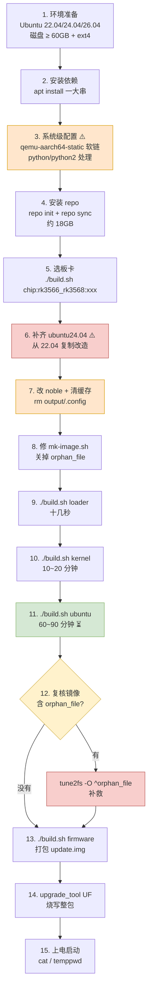

# Ubuntu 26.04 编译鲁班猫2（RK3568）Ubuntu 24.04 镜像完整教程

@[toc](目录)

## 前言

野火（EmbedFire）官方给出的鲁班猫 SDK 编译说明，主要针对 **Ubuntu 20.04 / 22.04** 宿主机，
且 SDK 自带的 rootfs 构建目录只到 `ubuntu22.04`。
而较新的 Ubuntu 24.04 / 26.04 宿主机上，由于包重命名、`qemu-user-static` 被移除、
`mkfs.ext4` 默认特性变更等原因，**照着官方文档走会在多个环节卡住**。

本文记录在 **Ubuntu 26.04** 上从零编译 **鲁班猫2（RK3568）Ubuntu 24.04 + 6.1 内核** 镜像的完整过程，
包含每一个真实报错的原因与修复方法。

> ⚠️ **重要前提**：官方 SDK 里**没有 `ubuntu24.04/` 目录**（只有 `ubuntu20.04` 和 `ubuntu22.04`）。
> 直接 `menuconfig` 选 noble 会因目标目录不存在而失败。本文包含**自己补齐该目录**的完整做法，见第七章。

**目标成果**：一个约 4 GB 的 `update.img`，烧录后进入 XFCE 桌面系统。

### 适用范围

| 项目 | 说明 |
| --- | --- |
| 宿主机 | Ubuntu 22.04 / 24.04 / 26.04（本文以 26.04 为例，差异点已标注） |
| 目标板卡 | 鲁班猫2（LubanCat-2，RK3568）；同族 RK3566 板卡亦可参考 |
| 目标系统 | Ubuntu 24.04 LTS (noble) + XFCE 桌面 |
| 内核 | 6.1.x |
| SDK | 鲁班猫通用 SDK（`lubancat_linux_generic.xml`） |

### 阅读建议

- 首次编译请**按顺序**通读，尤其不要跳过第三章的「系统级配置」、第七章的「补齐 ubuntu24.04 目录」；
- 第七章的目录补齐全流程都是新增工作，也是 24.04 与 22.04 最大的不同；
- 遇到报错先翻第十二章的踩坑汇总表，绝大多数都能对号入座。

### 本文目录

> CSDN 会自动生成右侧悬浮目录，这里列一份大纲方便快速定位。

```
零、一图看懂全流程 ⭐ ... 流程图 + 三个必看的坑
一、环境要求 .............. 硬件、系统、工具版本区间
二、安装依赖 .............. 26.04 适配的完整包清单
三、系统级配置 ⚠️ ......... qemu 软链 + python/python2 处理（必做）
四、安装 repo 工具
五、拉取通用 SDK .......... git 身份检查 + manifest 说明 + 网络问题处理
六、选择板卡配置 .......... 选定 rk3568 defconfig
七、补齐 ubuntu24.04 目录 ⚠️ 从 22.04 复制改造 + 切 noble + 清缓存
八、编译 .................. 分步编译与耗时参考
九、ext4 特性说明 ......... 24.04 不再踩坑，但脚本仍显式关闭
十、打包产物与烧录 ........ 正确工具是 upgrade_tool
十一、首次登录 ............ 默认账号密码
十二、踩坑汇总 ............ 踩坑对照表
十三、常见问题 FAQ
十四、参考资料
十五、配套脚本 ............ scripts/ 三个脚本与本文章节的对应关系
十六、编译清单 ............ 打勾对照
```

---

## 零、一图看懂全流程

> 如果你的编辑器不渲染下面的流程图，可以直接看后面的文字版。



**文字版流程**（编辑器不显示上图时看这个）：

```
[1] 环境准备（ext4 分区 + 60GB 空间）
     ↓
[2] sudo apt install 依赖包
     ↓
[3] 系统级配置：qemu-aarch64-static 软链 + python/python2 处理  ⚠️ 不做必失败
     ↓
[4] repo init + repo sync（拉 18GB 源码）
     ↓
[5] ./build.sh chip:rk3566_rk3568:LubanCat_rk3568_ubuntu_xfce_defconfig
     ↓
[6] 补齐 ubuntu24.04 目录（rsync 复制 ubuntu22.04，改 sources.list + 版本号）⚠️ SDK 不自带
     ↓
[7] 改 defconfig：RK_UBUNTU_FOCAL → RK_UBUNTU_NOBLE，并 rm output/.config
     ↓
[8] 改 ubuntu24.04/mk-image.sh 关掉 orphan_file（通用，建议保留）
     ↓
[9] ./build.sh loader        （十几秒）
     ↓
[10] ./build.sh kernel        （10~20 分钟）
     ↓
[11] sudo -v 然后 ./build.sh ubuntu （60~90 分钟，最耗时）⏳
     ↓
[12] 复核 ext4 特性：dumpe2fs -h ...rootfs.img | grep orphan_file
     ├─ 有 → sudo tune2fs -O ^orphan_file 后重打固件
     └─ 无 → 继续
     ↓
[13] ./build.sh firmware      （打包 update.img）
     ↓
[14] sudo upgrade_tool UF update.img                    ⚠️ 别用 rkdeveloptool
     ↓
[15] 上电启动，登录 cat / temppwd
```

### 四个必看的坑（不看会白折腾）

| 坑                | 位置  | 后果                            | 一句话解法                                      |
| ---------------- | --- | ----------------------------- | ------------------------------------------ |
| **git 身份未配置**    | 第五章 | `repo init` 直接抛异常退出           | `git config --global user.name/user.email` |
| **python2 缺失**   | 第三章 | `build.sh loader` 直接退出        | 建个转发到 python3 的 shim（并非真需要 Python 2）       |
| **SDK 缺 ubuntu24.04 目录** | 第七章 | 选 noble 后 `cd` 目标目录失败          | 从 `ubuntu22.04` 复制改造（本文给全命令）              |
| `.config` **缓存** | 第七章 | rootfs 编出来仍是旧版本，白等 60~90 分钟 | 删掉 `output/.config` 重新生成                   |

---

## 一、环境要求

### 1.1 硬件

| 项目 | 要求 |
| --- | --- |
| CPU | x86_64，建议 8 核以上（rootfs 阶段全程 qemu 模拟 arm64，非常吃 CPU） |
| 内存 | 建议 ≥ 16 GB |
| 磁盘 | **建议 ≥ 60 GB 可用空间**（源码约 18 GB，其中 `.repo` 占约 10 GB；编译产物与 rootfs 约 30 GB） |
| 板卡 | 鲁班猫2 + USB 数据线（A 口转 C 口或双 C 口均可） |

### 1.2 系统

```bash
cat /etc/os-release | head -3    # 确认发行版
uname -m                         # 必须是 x86_64
df -h ~                          # 确认可用空间 ≥ 60 GB
```

### 1.3 关键：SDK 必须放在 Linux 原生文件系统上

`build.sh` 会校验文件系统类型，放在 NTFS / exFAT / 网络盘（SMB、NFS）上会直接报错退出。

```bash
# 确认目标目录所在的文件系统
findmnt -no FSTYPE,OPTIONS,TARGET -T ~
```

输出应为 `ext4`、`f2fs`、`btrfs` 或 `xfs` 之一。

### 1.4 工具版本范围要求

不需要特定版本，满足以下区间即可：

| 工具          | 要求                                            |
| ----------- | --------------------------------------------- |
| `python3`   | ≥ 3.8（26.04 自带的 3.14 也能正常跑）                   |
| `git`       | ≥ 2.25                                        |
| `make`      | ≥ 4.2                                         |
| `gcc`       | ≥ 9（仅用于编译宿主工具，交叉编译用 SDK 自带工具链）                |
| `e2fsprogs` | ≥ 1.45（**版本越新越要注意第九章的** `orphan_file` **问题**） |

> 不需要手动安装交叉编译工具链，SDK 的 `prebuilts/` 目录里已自带。

---

## 二、安装依赖

### 2.1 一条命令装齐（26.04 适配版）

```bash
sudo apt update && sudo apt install -y \
  git ssh make gcc g++ libssl-dev \
  device-tree-compiler libfdt1 \
  qemu-user qemu-user-binfmt \
  flex bison bc lz4 m4 expect \
  patchelf chrpath gawk texinfo diffstat \
  live-build fakeroot cmake gcc-multilib g++-multilib \
  unzip libncurses-dev \
  python-is-python3 python3 python3-pip python3-pyelftools dpkg-dev \
  rsync cpio debootstrap u-boot-tools 7zip locales \
  libgmp-dev libmpc-dev libelf-dev uuid-dev \
  vim less file tree
```

### 2.2 为什么不能照抄官方文档

野火官方 README 里的包名是 20.04 / 22.04 时代的，在 24.04 及以后有多处失效：

| 官方文档的包                 | 新版 Ubuntu 情况    | 替代方案                                                    |
| ---------------------- | --------------- | ------------------------------------------------------- |
| `qemu-user-static`     | **仓库中已移除**      | `qemu-user` + `qemu-user-binfmt`                        |
| `liblz4-tool`          | 已改名             | `lz4`                                                   |
| `libncurses5-dev`      | 已移除             | `libncurses-dev`                                        |
| `p7zip-full`           | 已改名             | `7zip`                                                  |
| `python2`              | 已彻底移除           | 建 shim 转发到 python3（见 3.2，**实际不需要 Python 2**）            |
| `device-tree-compiler` | 存在，但**运行库需单独装** | 同时装 `libfdt1`                                           |
| `python`               | 不存在             | `python-is-python3`（**只解决** `python`**，不解决** `python2`） |

### 2.3 千万不要做的事

官方文档里可能有这么一条：

```bash
sudo dpkg -i debian/ubuntu-build-service/packages/*.deb
```

**在新版 Ubuntu 上绝对不要执行。** 这些是 22.04 时代的旧包
（如 `debootstrap_1.0.126`、`qemu_6.2`），安装后会把系统组件降级，
后续 rootfs 阶段容易出现难以排查的依赖冲突。

正确做法是用 apt 装的同名新包，也就是 2.1 那条命令里已经包含的
`debootstrap` 和 `qemu-user-binfmt`。

### 2.4 各包的作用说明

安装量比较大，简单说明关键几个：

| 包 | 用途 | 缺失时的报错 |
| --- | --- | --- |
| `device-tree-compiler` | 编译设备树 | `ERROR: No 'dtc'` |
| `libfdt1` | `dtc` 的运行库 | `fdtget: libfdt.so.1: cannot open` |
| `flex` / `bison` | 内核 Kconfig 解析 | `flex: not found` |
| `lz4` | 内核镜像压缩 | `lz4: command not found` |
| `qemu-user-binfmt` | 在 x86 上执行 arm64 程序 | `Exec format error` |
| `python-is-python3` | 提供 `python` → `python3` 软链 | `Your python-is-python3 is missing`（注意**不含** `python2`） |

> `libncurses-dev` 看起来只是给 `menuconfig` 界面用的，实际它有个**更隐蔽的坑**：
> 装着它在新版 GCC 上照样会报「找不到 ncurses」。原因和处理见 **3.3**。

---

## 三、系统级配置（必做）

官方文档没有提到这两步，但新版 Ubuntu 上**不做就一定失败**。

### 3.1 补 `qemu-aarch64-static` 软链

SDK 的 `mk-base-ubuntu.sh` 和 `mk-ubuntu-rootfs.sh` 里硬编码了：

```bash
sudo cp /usr/bin/qemu-aarch64-static $TARGET_ROOTFS_DIR/usr/bin/
```

而新版 Ubuntu 的 `qemu-user` 只提供 `/usr/bin/qemu-aarch64`（static-pie 格式），
文件名不带 `-static` 后缀。所以必须补一个软链：

```bash
sudo ln -sf /usr/bin/qemu-aarch64 /usr/bin/qemu-aarch64-static
ls -l /usr/bin/qemu-aarch64-static     # 确认软链已建立
```

**验证 qemu 真的能跑 arm64**（这一步能提前排除 rootfs 阶段白跑的风险）：

```bash
# 1) binfmt 是否注册
ls /proc/sys/fs/binfmt_misc/ | grep qemu-aarch64

# 2) 解出 ubuntu-base 里的 arm64 程序试跑
#    注意：先做完第七章，ubuntu24.04/ 目录和 base 包才会存在
mkdir -p /tmp/qt
BASE_TGZ=$(ls ~/LubanCat_SDK/ubuntu24.04/ubuntu-base-24.04.5-base-arm64.tar.gz 2>/dev/null \
        || ls ~/LubanCat_SDK/ubuntu22.04/ubuntu-base-22.04.5-base-arm64.tar.gz 2>/dev/null | head -1)
tar -xzf "$BASE_TGZ" -C /tmp/qt 2>/dev/null
QEMU_LD_PREFIX=/tmp/qt /tmp/qt/usr/bin/true && echo "qemu 可执行 arm64 ✓"
```

> 如果直接执行 `./true` 报 `Could not open '/lib/ld-linux-aarch64.so.1'`，
> 这是**正常的**——宿主机没有 aarch64 动态链接器。加 `QEMU_LD_PREFIX`
> 或者进入 chroot 内部运行即可。

### 3.2 处理 `python` 与 `python2`（两个不同的东西）

新版 Ubuntu 上，SDK 在**两个不同阶段**会分别检查 `python` 和 `python2` 这两个命令。
它们名字不同、用途不同、解决方法也不同，**必须分开处理**：

| 命令 | 检查位置 | 用途 | 解决方法 |
| --- | --- | --- | --- |
| `python` | `check-kernel.sh`（内核编译） | 内核构建脚本调用 | `apt install python-is-python3` |
| `python2` | `check-loader.sh`（u-boot 编译） | 见下方分析 | **建 shim 转发到 python3** |

#### 先解决 `python`

```bash
sudo apt install -y python-is-python3
python -V      # 应输出 Python 3.x
```

#### 再解决 `python2`：不需要真的 Python 2

`check-loader.sh` 全文就这么几行：

```bash
if ! which python2 >/dev/null; then
	echo "Your python2 is missing for U-Boot"
	exit 1
fi
```

它**只判断** `which python2` **是否成功，不检查版本号**。所以核心问题是：
SDK 到底有没有真的调用过 Python 2 特有的功能？答案是**没有**。

**证据一：**`PYTHON` **变量在 u-boot 里只有一个使用者**

`u-boot/make.sh` 编译时传了 `make PYTHON=python2 ...`，而 `PYTHON` 变量在整个
u-boot 里只被一处使用：

```bash
# u-boot/scripts/dtc/pylibfdt/Makefile
$(PYTHON) $< --quiet build_ext --inplace
```

也就是只用来构建 `pylibfdt`。

**证据二：**`pylibfdt` **在 rk3568 配置下根本不参与编译**

```bash
# u-boot/scripts/dtc/Makefile:34
subdir-$(CONFIG_PYLIBFDT) += pylibfdt
```

也就是说，只有 `CONFIG_PYLIBFDT=y` 时才会进这个目录。而实测 rk3568 的 `.config`：

```bash
$ grep -E "PYLIBFDT|SPL_OF_PLATDATA" ~/LubanCat_SDK/u-boot/.config
# CONFIG_SPL_OF_PLATDATA is not set
```

`CONFIG_PYLIBFDT` **连定义都没有**（不存在即关闭），`SPL_OF_PLATDATA` 也显式关闭。

**证据三：相关产物确认从未生成**

```bash
$ find ~/LubanCat_SDK/u-boot -name "_libfdt*.so" -o -name "dtoc"
（无任何输出）
```

两个唯一可能需要 Python 的东西，编译完都不存在。

**结论**：只要让 `which python2` 能成功即可，至于它背后是 Python 2 还是 3，SDK 并不关心。

#### 方案 A：建 shim 转发到 python3（推荐）

```bash
mkdir -p ~/bin

cat > ~/bin/python2 <<'SHIM'
#!/bin/sh
# python2 兼容 shim
# 原因：SDK 的 check-loader.sh 硬性检查 python2 是否存在，
#       但 rk3568 配置下 PYTHON 变量只用于构建 pylibfdt，
#       而 CONFIG_PYLIBFDT / CONFIG_SPL_OF_PLATDATA 均未启用，
#       所以 Python 2 的功能从未被真正调用。转发到 python3 即可。
exec python3 "$@"
SHIM

chmod +x ~/bin/python2

# 加入 PATH（写进 ~/.bashrc 才能长期生效）
echo 'export PATH=$HOME/bin:$PATH' >> ~/.bashrc
source ~/.bashrc
```

**验证两个命令都正常：**

```bash
$ python  -V     # Python 3.x   ← 来自 python-is-python3
$ python2 -V     # Python 3.x   ← 来自 shim
$ which python2  # /home/<user>/bin/python2  ← 非空，check-loader.sh 就满意
```

> **这个 shim 要一直留着。** 删掉之后 `./build.sh loader` 会立刻重新报错，
> 而 u-boot 一旦重编又要多等一轮。

#### 替代写法：建符号链接（更简洁）

不想维护一个脚本文件的话，用软链效果完全一样：

```bash
sudo ln -sf /usr/bin/python3 /usr/local/bin/python2
python2 -V
```

放在 `/usr/local/bin` 而不是 `/usr/bin`，可以避免和包管理器管理的文件冲突，
同时又能被 `which` 正常找到。

#### 为什么不建议装真正的 Python 2

SDK 自带 `install-python2.sh`，它会调用 `install-python.sh 2.7.18` 从源码编译
Python 2.7.18。不建议这样做，原因有三：

1. **耗时**——从源码编译需要几分钟，而它对你毫无用处（从未被调用）；
2. **Python 2 已于 2020 年停止维护**，装一个 EOL 的解释器进系统没有意义；
3. **可能污染环境**——编译出的 `python2` 会进 `/usr/local/bin`，日后容易与其他项目冲突。

#### 为什么不能只用 `python-is-python3` 解决

这是最容易混淆的一点。`python-is-python3` 提供的软链是：

```
/usr/bin/python -> python3
```

它解决的是 `python` **这个命令**，**不会创建** `python2`。所以：

```bash
sudo apt install python-is-python3   # 解决了 python
./build.sh loader                    # 仍然报 "Your python2 is missing"
```

两个都要做，缺一不可。

### 3.3 修复 `menuconfig` 报「找不到 ncurses」

第一次跑 `./build.sh menuconfig` 很可能遇到：

```
 *** Unable to find the ncurses libraries or the
 *** required header files.
 *** 'make menuconfig' requires the ncurses libraries.
 ***
 *** Install ncurses (ncurses-devel or libncurses-dev
 *** depending on your distribution) and try again.
 ***
ERROR: exit code 2 from line 178:
```

**这条报错是误导性的——它和 ncurses 一点关系都没有。**

可以先自查一下，通常会看到 ncurses 其实是齐全的：

```bash
dpkg -l libncurses-dev        # 已安装
ls /usr/include/ncurses.h     # 头文件在
pkg-config --libs ncursesw    # 输出 -lncursesw
```

#### 真正的原因：GCC 15 默认 C23

`kconfig/lxdialog/check-lxdialog.sh` 用这么一段代码测试 ncurses 能否链接：

```c
#include CURSES_LOC
main() {}
```

注意 `main()` **没有返回类型**。这是 K&R 时代的写法，在 GCC 14 及以前只是
`-Wimplicit-int` 警告，能正常编译。而 **GCC 15 把默认方言切到 C23**，
隐式返回类型 `int` 被移出标准，直接升级为**错误**：

```
<stdin>:2:1: error: return type defaults to ‘int’ [-Wimplicit-int]
```

脚本只要发现编译失败，就一律打印「找不到 ncurses」，不管你实际是因为什么失败的。
于是 ncurses 齐全却报 ncurses 缺失。

查看自己的 GCC 是否为 15+：

```bash
gcc --version | head -1
# gcc (Ubuntu 15.2.0-16ubuntu1) 15.2.0   ← 会踩
# gcc (Ubuntu 13.2.0-...) 13.2.0         ← 不踩
```

#### 修法一：临时降警告级别（推荐，不改 SDK 源码）

`check-lxdialog.sh` 的编译参数来自 Makefile 的 `HOST_EXTRACFLAGS`，
在命令行覆盖它即可：

```bash
HOST_EXTRACFLAGS="-Wno-implicit-int" ./build.sh menuconfig
```

也可以写成一次性的环境变量，避免每次都敲：

```bash
echo 'export HOST_EXTRACFLAGS="-Wno-implicit-int"' >> ~/.bashrc
source ~/.bashrc
```

> 这个改动只影响 `menuconfig` 的宿主机工具编译，**不会进入最终镜像**，
> 对内核、u-boot、rootfs 的产物没有任何影响。

#### 修法二：直接改脚本（一劳永逸）

把那段测试代码改成标准 C：

```bash
cd ~/LubanCat_SDK/device/rockchip/common/kconfig/lxdialog
sed -i 's/^main() {}$/int main(void) { return 0; }/' check-lxdialog.sh
grep -n "int main" check-lxdialog.sh    # 确认已改
```

验证是否修好：

```bash
FLAGS=$(./check-lxdialog.sh -ccflags | tr '\n' ' ')
eval "./check-lxdialog.sh -check gcc -Wno-implicit-int $FLAGS" && echo "✓ ncurses 检测通过"
```

> 这个文件受 git 管理，改完 `repo sync` 会被还原。`repo` 会提示有本地修改，
> 用 `git checkout check-lxdialog.sh` 可随时还原。嫌麻烦就用修法一。

#### 补充：`pkg-config` 也可能没装

`check-lxdialog.sh` 会先尝试 `pkg-config --libs ncursesw`。Ubuntu 26.04 的最小安装
不一定带 `pkg-config`（新版包名叫 `pkgconf`）：

```bash
command -v pkg-config || sudo apt install pkgconf
```

不过即使没装，脚本还有用 `gcc -print-file-name` 探测的兜底逻辑，能自己找到 `-lncursesw`，
**不是这次报错的原因**，但装上更稳。

---

## 四、安装 repo 工具

```bash
mkdir -p ~/bin
curl -sSL https://storage.googleapis.com/git-repo-downloads/repo -o ~/bin/repo
chmod a+x ~/bin/repo
echo 'export PATH=$HOME/bin:$PATH' >> ~/.bashrc
source ~/.bashrc

repo --version
```

如果访问不了 Google 存储，可以用 apt 版：

```bash
sudo apt install -y repo
```

> 网上一些老教程里写的 `gerrit-googlesource.proxy.ustclug.org` 镜像地址，
> 目前已经无法解析，不要再用。

---

## 五、拉取通用 SDK

### 5.0 前置检查：先配好 git 身份

**这一步官方文档没有提，但不做** `repo init` **一定失败。**

`repo init` 的最后阶段要调用 `_ConfigureUser()` 读取 git 提交者身份
（`GIT_COMMITTER_IDENT`），而该身份由 `user.name` 和 `user.email` 拼成。
两者缺任何一个，就会抛出：

```
git_command.GitCommandError: 'var GIT_COMMITTER_IDENT' on manifests failed
stderr: 提交者身份未知

*** 请告诉我您是谁。

运行

  git config --global user.email "you@example.com"
  git config --global user.name "Your Name"
```

**注意**：这个报错和 `repo init` 的命令参数无关，命令本身没问题，
纯粹是缺少 git 身份的隐含前提。很多人会误以为是镜像地址或网络的问题。

配置方式（换成你自己的信息即可，不必是真实邮箱）：

```bash
git config --global user.name  "你的名字"
git config --global user.email "you@example.com"
```

**验证必须通过再往下走：**

```bash
git var GIT_COMMITTER_IDENT
# 正常输出类似：你的名字 <you@example.com> 1758720000 +0800
```

一行脚本形式的前置检查（会自己判断并提示）：

```bash
git var GIT_COMMITTER_IDENT >/dev/null 2>&1 || {
  echo "git 身份未配置，请先设置："
  echo '  git config --global user.name  "你的名字"'
  echo '  git config --global user.email "you@example.com"'
}
```

> 如果已经有 GitHub 账号，建议直接用账号邮箱，这样后面提交改动时不会出现身份不一致。

### 5.1 初始化

```bash
mkdir -p ~/LubanCat_SDK
cd ~/LubanCat_SDK

# repo 本体走中科大镜像，避免 gerrit.googlesource.com 拉不到
repo init --depth=1 \
  --repo-url https://mirrors.ustc.edu.cn/aosp/git-repo \
  -u https://github.com/LubanCat/manifests.git \
  -b linux -m lubancat_linux_generic.xml

# repo 本体走github中转站
repo init --depth=1 \
  -u https://gh-proxy.org/https://github.com/LubanCat/manifests.git \
  -b linux -m lubancat_linux_generic.xml
```

> ⚠️ **中科大镜像的路径是** `/aosp/git-repo`**，不是** `/git/git-repo`**。**
> 网上不少教程写的是 `mirrors.ustc.edu.cn/git/git-repo`，
> 这个地址现在返回「仓库未找到」，不要用。
>
> 清华镜像 `mirrors.tuna.tsinghua.edu.cn/git/git-repo` 目前仍可用，
> 但近期出现过不稳定，中科大相对更稳，本文以中科大为主。

**关于** `-m lubancat_linux_generic.xml`：这是选择用哪份清单文件。
`repo` 通过 XML 清单管理「SDK 由哪些 git 仓库组成」，`-m` 指定的就是这份清单。
本清单声明了 13 个 `<project>` 条目（内核 5.10/6.1、u-boot、rkbin、tools、lubancat-bin、
ubuntu20.04/22.04、debian11/12、device_rockchip，以及 `prebuilts` 下的两条工具链），
每个都固定了精确的 commit，保证每次拉取的内容完全一致。

其中 `prebuilts` 的两条 `<project>` 检出到同一父目录的不同子路径，所以顶层只看到一个
`prebuilts/`；`device_rockchip` 则通过 3 条 `<linkfile>` 生成 `build.sh`、`Makefile`、`rkflash.sh`。

**init 成功的标志**：

```
repo has been initialized in /home/<user>/LubanCat_SDK
```

首次运行还会询问是否启用彩色输出：

```
Testing colored output (for 'repo diff', 'repo status'):
Enable color display in this user account (y/N)? y
```

选 `y` 即可（只影响日志颜色，会写入 `~/.repoconfig`）。

> 如果重跑时看到 `repo: reusing existing repo client checkout in ...`，
> 说明 `.repo` 已存在，`repo` 会复用并继续初始化，**这是正常的，不用删除**。

### 5.2 同步源码

```bash
.repo/repo/repo sync -c -j4
```

源码约 **18 GB**（`.repo` 元数据约 10 GB，各仓库检出约 8 GB），视网络状况通常几分钟到几十分钟，建议到空闲的时间拉取。

拉完后的目录结构如下（`tree -La 1` 的实际输出，13 个仓库 + 3 个软链）：

```
LubanCat_SDK/
├── .repo/                        # repo 元数据（9~10 GB，ls 默认看不到，需 -a）
├── build.sh -> device/rockchip/common/scripts/build.sh
├── debian11/                     # bullseye（本教程不用）
├── debian12/                     # bookworm（本教程不用）
├── device/                       # 板级配置（.chips/ 下按 SoC 分目录）
├── kernel-5.10/                  # 5.10 内核（本教程不用）
├── kernel-6.1/                   # 6.1 内核（本教程使用）
├── lubancat-bin/                 # 野火板级专用二进制（DTB、overlay 等）
├── Makefile -> device/rockchip/common/Makefile
├── prebuilts/                    # 交叉工具链（嵌套结构，见下方说明）
├── rkbin/                        # Rockchip 预编译二进制（DDR 初始化等）
├── rkflash.sh -> device/rockchip/common/scripts/rkflash.sh
├── tools/                        # 打包/烧录工具（含 upgrade_tool）
├── u-boot/                       # 引导 + TPL/SPL
├── ubuntu20.04/                  # focal 根文件系统源码
└── ubuntu22.04/                  # jammy 根文件系统源码
                                  # 注意：SDK 不带 ubuntu24.04/，需自行补齐（见第七章）
```

> `tree -L 1` 会输出 `13 directories, 3 files` —— 13 个目录 + 3 个软链（软链算文件），
> **但看不到 `.repo`**。加 `-a` 后才是 `14 directories, 3 files`，即上面这份完整清单。
> 所以别拿 `tree -L 1` 里没有 `.repo` 来判断"是不是漏拉了"。

3 个软链由 manifest 里的 `<linkfile>` 自动创建，**不是手动建的**：

| 软链 | 指向 |
| --- | --- |
| `build.sh` | `device/rockchip/common/scripts/build.sh` |
| `Makefile` | `device/rockchip/common/Makefile` |
| `rkflash.sh` | `device/rockchip/common/scripts/rkflash.sh` |

`prebuilts` 不是扁平目录，manifest 里有两个 `<project>` 直接检出到深层路径：

```
prebuilts/gcc/linux-x86/
├── aarch64/gcc-arm-10.3-2021.07-x86_64-aarch64-none-linux-gnu/   # 64 位 ARM 工具链（编内核/u-boot）
└── arm/    gcc-arm-10.3-2021.07-x86_64-arm-none-linux-gnueabihf/ # 32 位 ARM 工具链（编 rkbin 等）
```

### 5.2.1 同步完整性自检

`repo sync` 跑完不代表没缺仓库（中途失败会跳过单个项目）。用下面这段确认 13 个仓库全部检出：

```bash
cd ~/LubanCat_SDK
for p in device/rockchip kernel-5.10 kernel-6.1 u-boot rkbin tools lubancat-bin \
         ubuntu20.04 ubuntu22.04 debian11 debian12 \
         prebuilts/gcc/linux-x86/aarch64/gcc-arm-10.3-2021.07-x86_64-aarch64-none-linux-gnu \
         prebuilts/gcc/linux-x86/arm/gcc-arm-10.3-2021.07-x86_64-arm-none-linux-gnueabihf; do
  [ -e "$p/.git" ] && printf '  OK  %s\n' "$(basename $p)" || printf '  MISSING  %s\n' "$(basename $p)"
done
```

全部 `OK` 才算拉全。若输出里有 `MISSING`，单独补拉那一个：

```bash
.repo/repo/repo sync -c -j4 --force-sync <仓库目录名>
```

再顺手验证交叉工具链能跑（确认不是空目录）：

```bash
prebuilts/gcc/linux-x86/aarch64/gcc-arm-10.3-2021.07-x86_64-aarch64-none-linux-gnu/bin/aarch64-none-linux-gnu-gcc --version
```

正常应输出 `aarch64-none-linux-gnu-gcc (GNU Toolchain for the A-profile Architecture 10.3-2021.07) 10.3.1`。

### 5.3 拉取失败的常见处理

**报错一：**`GnuTLS recv error (-110): The TLS connection was non-properly terminated`

这是 GitHub 的 git 通道被 RST 打断，国内网络很常见。先做调优再重试：

```bash
git config --global http.postBuffer 524288000
git config --global http.lowSpeedLimit 0
git config --global http.lowSpeedTime 999999
git config --global http.version HTTP/1.1

# 清掉半成品，重新来
cd ~/LubanCat_SDK && rm -rf .repo
```

**报错二：**`Cannot get .../git-repo/clone.bundle`

缺少 `--repo-url`，加上镜像地址即可（5.1 已经包含）。

**报错三：**`Repo command failed: UpdateManifestError`

```bash
rm -rf ~/LubanCat_SDK/.repo/manifests*
# 然后重新 repo init
```

**报错四：**`Current user is not the owner of SDK source`

之前用 root 跑过导致属主变了：

```bash
sudo chown -h -R $USER:$USER ~/LubanCat_SDK
```

**报错五：**`GitCommandError: 'var GIT_COMMITTER_IDENT' ... failed` **/** `提交者身份未知`

git 全局身份没配置，和网络、镜像地址都无关。解决方法见 **5.0**：

```bash
git config --global user.name  "你的名字"
git config --global user.email "you@example.com"
git var GIT_COMMITTER_IDENT        # 能正常输出即通过
```

**补充**：`repo sync` 中断后直接重跑同一条命令即可，会自动续传，不用删目录。

---

## 六、选择板卡配置

### 6.1 一条命令选定（推荐）

```bash
cd ~/LubanCat_SDK
./build.sh chip:rk3566_rk3568:LubanCat_rk3568_ubuntu_xfce_defconfig
```

执行后可见类似输出：

```
Switching to chip: rk3566_rk3568
Switching to defconfig: .../LubanCat_rk3568_ubuntu_xfce_defconfig
# configuration written to .../output/.config
Using preferred kernel version(6.1)
Switching to kernel-6.1
```

### 6.2 交互菜单方式（等价）

```bash
./build.sh chip
```

```
Pick a chip:
1. rk312x      2. rk3528      3. rk3562
4. rk3566_rk3568    <-- 鲁班猫2 的 RK3568 属于这一族
5. rk3576      6. rk3588
Which would you like? []: 4
```

然后选 defconfig，`rk3566_rk3568` 下共有 12 个选项：

```
 1. LubanCat_rk3566_buildroot_extboot_defconfig
 ...
 5. LubanCat_rk3566_ubuntu_lite_defconfig
 6. LubanCat_rk3566_ubuntu_xfce_defconfig
 ...
11. LubanCat_rk3568_ubuntu_lite_defconfig    <-- RK3568 无桌面
12. LubanCat_rk3568_ubuntu_xfce_defconfig    <-- RK3568 + XFCE（本教程选择）
Which would you like? [1]: 12
```

### 6.3 关键 defconfig 字段说明

选定后，配置文件位于：

```
device/rockchip/.chips/rk3566_rk3568/LubanCat_rk3568_ubuntu_xfce_defconfig
```

其中几项需要了解：

```
RK_UBUNTU_NOBLE=y                            # 目标系统版本（关键，见第七章）
RK_ROOTFS_SYSTEM_UBUNTU=y
RK_ROOTFS_TARGET_XFCE=y                      # 桌面环境
RK_ROOTFS_IMAGE="ubuntu-rk356x-${RK_ROOTFS_TARGET}-rootfs.img"
RK_KERNEL_PREFERRED="6.1"                    # 内核版本，可改 "5.10"
RK_KERNEL_CFG="lubancat_linux_rk356x_defconfig"
RK_KERNEL_DTS_NAME="rk356x-lubancat-generic" # 鲁班猫2 通用设备树
RK_KERNEL_EXTBOOT=y                          # 使用 extboot(FIT) 启动方式
RK_PARAMETER="parameter-extboot.txt"
RK_USE_FIT_IMG=y
RK_PACKAGE_FILE_CUSTOM=y
RK_PACKAGE_FILE="package-file-extboot"
```

---

## 七、补齐 ubuntu24.04 目录并切换（关键步骤）

这一步是 22.04 教程里完全没有的，也是 24.04 最大的工作量。

### 7.1 先看清 SDK 到底有什么

```bash
cd ~/LubanCat_SDK
ls -d ubuntu* debian*
```

**实际输出只有两个 Ubuntu 目录**：

```
ubuntu20.04  ubuntu22.04
```

**SDK 里没有 `ubuntu24.04`。** 但 Kconfig 里明明写了 noble：

```bash
grep -A12 'config RK_UBUNTU_VERSION' device/rockchip/common/configs/Config.in.ubuntu
```

```startLine:23:32:device/rockchip/common/configs/Config.in.ubuntu
config RK_UBUNTU_VERSION
	string
	default "focal" if RK_UBUNTU_FOCAL
	default "jammy" if RK_UBUNTU_JAMMY
	default "noble" if RK_UBUNTU_NOBLE

config RK_UBUNTU_NUMBER
	string
	default "ubuntu20.04" if RK_UBUNTU_FOCAL
	default "ubuntu22.04" if RK_UBUNTU_JAMMY
	default "ubuntu24.04" if RK_UBUNTU_NOBLE
```

而 `mk-rootfs.sh` 是这么进入构建目录的：

```startLine:241:241:device/rockchip/common/scripts/mk-rootfs.sh
	cd "$RK_UBUNTU_NUMBER"
```

**结论**：选了 noble 之后，脚本会 `cd ubuntu24.04`，但该目录不存在，
`cd` 失败 → 整个 rootfs 构建在这一行断掉。

> 这是「Kconfig 有选项但上游没提供实现」的典型情况。官方 defconfig 默认停在 focal，
> 也许正是因为 noble 这条路径从未被真正验证过。

### 7.2 补齐目录：从 ubuntu22.04 复制

`ubuntu22.04/` 里真正参与构建的只有脚本和几个素材目录，产物（`binary/`、`.tar.gz`、`.img`）
占了大头，**必须先排除再复制**，否则会白拷 8 GB。

```bash
cd ~/LubanCat_SDK

# 先看子项大小，确认哪些是大件
du -sh ubuntu22.04/* | sort -h | tail -6
```

典型输出：

```
976K   ubuntu22.04/overlay
27M    ubuntu22.04/ubuntu-base-22.04.5-base-arm64.tar.gz
87M    ubuntu22.04/overlay-firmware
264M   ubuntu22.04/packages
963M   ubuntu22.04/ubuntu-base-xfce-arm64-20261125.tar.gz
3.4G   ubuntu22.04/binary
3.5G   ubuntu24.04/ubuntu-rk356x-xfce-rootfs.img
```

复制时把后三项排掉：

```bash
cd ~/LubanCat_SDK
rsync -a \
  --exclude 'binary' \
  --exclude '*.tar.gz' \
  --exclude '*.img' \
  ubuntu22.04/ ubuntu24.04/

du -sh ubuntu24.04        # 期望约 370 MB
```

> **为什么不用 `cp -a`**：`binary/` 里全是 root 属主的文件（`/etc/shadow`、`/root`、
> `/etc/ssl/private` 等），普通用户 `cp` 会刷出几十行 `权限不够`，
> 命令以非零状态退出，后续清理被跳过。`rsync --exclude` 从源头上就不碰它们。

复制完的目录结构：

```
ubuntu24.04/
├── Docker/
├── add-build-info.sh
├── ch-mount.sh
├── mk-base-ubuntu.sh          ← 需要改版本号
├── mk-image.sh                ← 需要改 orphan_file 注释
├── mk-ubuntu-rootfs.sh
├── overlay/                   ← 桌面定制、开机脚本等
├── overlay-debug/
├── overlay-firmware/
├── packages/                  ← 预置 deb（mali、camera 等），与版本无关，直接复用
├── post-build.sh
├── readme.md
├── sources.list               ← 必须改 jammy → noble
└── ubuntu-build-service/
```

### 7.3 改造三处

**① `sources.list` 全部换 noble**

```bash
cd ~/LubanCat_SDK/ubuntu24.04
sed -i 's/\bjammy\b/noble/g' sources.list
cat sources.list
```

期望：

```
deb http://mirrors.aliyun.com/ubuntu-ports/ noble main multiverse restricted universe
deb http://mirrors.aliyun.com/ubuntu-ports/ noble-backports main multiverse restricted universe
deb http://mirrors.aliyun.com/ubuntu-ports/ noble-security main multiverse restricted universe
deb http://mirrors.aliyun.com/ubuntu-ports/ noble-updates main multiverse restricted universe
```

**② `mk-base-ubuntu.sh` 改基础 rootfs 的版本号与下载地址**

```bash
cd ~/LubanCat_SDK/ubuntu24.04
sed -i -e 's|ubuntu-base-22\.04\.5-base-|ubuntu-base-24.04.5-base-|g' \
       -e 's|releases/22\.04/release|releases/24.04/release|g' mk-base-ubuntu.sh
grep -n 'ubuntu-base-24' mk-base-ubuntu.sh
```

> ⚠️ **两条替换规则必须写成两个 `-e`**，不要用 `'s|a|b|g; \` + 换行 +
> `s|c|d|g'` 这种单引号内续行的写法。单引号里的 `\` 换行会被 `sed` 当成
> 正则的一部分，导致 `sed: -e 表达式 #1: 未终止的地址正则表达式`。

期望四行全部指向 24.04：

```startLine:45:49:LubanCat_SDK/ubuntu24.04/mk-base-ubuntu.sh
    if [ ! -e ubuntu-base-24.04.5-base-$ARCH.tar.gz ]; then
        echo "\033[36m wget ubuntu-base-24.04.5-base-"$ARCH".tar.gz \033[0m"
        wget -c http://cdimage.ubuntu.com/ubuntu-base/releases/24.04/release/ubuntu-base-24.04.5-base-$ARCH.tar.gz
    fi
    sudo tar -xzf ubuntu-base-24.04.5-base-$ARCH.tar.gz -C $TARGET_ROOTFS_DIR/
```

**先验证这个文件名真实存在**（避免脚本跑到下载那一步才发现 404）：

```bash
curl -sI http://cdimage.ubuntu.com/ubuntu-base/releases/24.04/release/ubuntu-base-24.04.5-base-arm64.tar.gz \
  | head -1
# 期望：HTTP/1.1 200 OK
```

**③ `readme.md` 里的版本描述**（纯文本，不影响编译，改了更清楚）

```bash
sed -i -e 's|ubuntu 22\.04 (Jammy-X11)|ubuntu 24.04 (Noble-X11)|' \
       -e 's|## 构建 Ubuntu22\.04镜像|## 构建 Ubuntu24.04镜像|' readme.md
```

改完检查语法，确保没把脚本改坏：

```bash
for f in mk-base-ubuntu.sh mk-image.sh mk-ubuntu-rootfs.sh; do bash -n $f && echo "$f OK"; done
```

### 7.4 再切 defconfig 到 noble

`FOCAL / JAMMY / NOBLE` 是 **choice** 类型，**同一时间只能有一个为** `y`。
所以不能只加 `RK_UBUNTU_NOBLE=y`，必须先把其他两个关掉。

**方式一：交互菜单**

```bash
cd ~/LubanCat_SDK
HOST_EXTRACFLAGS="-Wno-implicit-int" ./build.sh menuconfig
# 进入 System configuration -> Rootfs -> Ubuntu -> distro，选 noble
```

> `HOST_EXTRACFLAGS` 是避开 GCC 15 的 ncurses 误报，原因见 **3.3**。
> 如果你的 GCC 是 14 及以前，可以去掉这个前缀直接跑。

**方式二：直接改文件（推荐，可脚本化）**

```bash
cd ~/LubanCat_SDK
CFG=device/rockchip/.chips/rk3566_rk3568/LubanCat_rk3568_ubuntu_xfce_defconfig
cp -n $CFG ${CFG}.bak

# 先把三个选项全部关掉，再单独打开 noble
sed -i -E 's/^RK_UBUNTU_(FOCAL|JAMMY|NOBLE)=y/# RK_UBUNTU_\1 is not set/' $CFG
sed -i '1i RK_UBUNTU_NOBLE=y' $CFG

# 必须只有一行 =y
grep -cE '^RK_UBUNTU_(FOCAL|JAMMY|NOBLE)=y' $CFG     # 期望输出 1
```

### 7.5 最容易踩的坑：`output/.config` 不会自动刷新

**这个坑在 24.04 上同样存在，而且更致命**——因为如果 `.config` 没刷新成 noble，
你辛苦补的 `ubuntu24.04/` 目录根本不会被用到，编出来的还是 `ubuntu22.04` 的内容。

原因是 `mk-config.sh` 里的 `prepare_config()` 靠**文件时间戳**判断是否需要重新生成配置，
用 `sed` 改文件后时间戳判断不可靠，编译时用的还是旧配置。

**所以必须手动清掉缓存再重新生成：**

```bash
cd ~/LubanCat_SDK
rm -f output/.config output/.config.old
./build.sh defconfig:LubanCat_rk3568_ubuntu_xfce_defconfig

# 复核，这一步不能省
grep -E 'RK_UBUNTU_(VERSION|NUMBER|FOCAL|JAMMY|NOBLE)' output/.config
```

期望输出：

```
RK_UBUNTU_VERSION="noble"
RK_UBUNTU_NUMBER="ubuntu24.04"
# RK_UBUNTU_FOCAL is not set
# RK_UBUNTU_JAMMY is not set
RK_UBUNTU_NOBLE=y
```

> 最后再确认一遍目标目录存在，这是本方案和 22.04 教程唯一的结构性差别：
>
> ```bash
> ls -d ~/LubanCat_SDK/$(grep -oP '(?<=RK_UBUNTU_NUMBER=")[^"]+' output/.config)
> ```

---

## 八、编译

### 8.1 推荐分步编译

分步的好处是**哪一步失败只看那一步的日志**，不会因为最后一步出错而丢掉
前面已经编好的成果。

```bash
cd ~/LubanCat_SDK
export PATH=$HOME/bin:$PATH      # 让 python2 shim 生效

# ── 编译前：确认 mk-image.sh 的 mkfs 参数（见 9.5）──────────
# 24.04 目标系统自带 e2fsck 1.47，理论上不需要这一步，
# 但保留后同一套脚本可兼容 22.04，且对 24.04 无副作用。
grep -A1 "MKFS_OPTS" ubuntu24.04/mk-image.sh    # 确认已改
bash -n ubuntu24.04/mk-image.sh                 # 确认语法没问题

# u-boot + trust + MiniLoaderAll.bin
./build.sh loader
# 6.1 内核 + dtb + extboot.img
./build.sh kernel
# 提前认证 sudo（rootfs 阶段必须，见 8.3 / 8.6）
sudo -v
# rootfs（需要 sudo）
./build.sh ubuntu

# ── rootfs 出来后立刻验证 ext4 特性 ───────────────────────
IMG=ubuntu24.04/ubuntu-rk356x-xfce-rootfs.img
dumpe2fs -h $IMG 2>/dev/null | grep -q orphan_file \
  && echo "❌ 仍有 orphan_file，执行该命令修复: sudo tune2fs -O ^orphan_file $IMG" \
  || echo "✅ ext4 特性 OK"

# 打包 + 生成 update.img
./build.sh firmware
```

> **两个别省的地方：**
>
> 1. `sudo -v`。少了它，rootfs 结尾打包时 `sudo umount` 可能因密码超时失败，
>
>    导致 `tar` 把宿主机的 `/proc` 打进包里，生成一个**看起来成功但完全不能用**的废包。
> 2. 编译前 `ls -d ubuntu24.04` 确认目录在。第七章没做的话，`./build.sh ubuntu`
>
>    会在 `cd ubuntu24.04` 那行直接失败。

**参考耗时**（8 核以上 x86_64 + SSD）：

| 命令 | 产物 | 耗时 |
| --- | --- | --- |
| `./build.sh loader` | `rk356x_spl_loader_*.bin`、`uboot.img` | 十几秒 |
| `./build.sh kernel` | `Image`、`rk356x-lubancat-generic.dtb`、`extboot.img` | 10~20 分钟 |
| `./build.sh ubuntu` | `ubuntu-rk356x-xfce-rootfs.img` | **60~90 分钟** |
| `./build.sh firmware` | `update.img`（约 4 GB） | 半分钟左右 |

rootfs 为什么这么慢：需要在 chroot 里通过 apt 安装 XFCE 桌面所需的
**上千个 deb 包**，而且全程用 qemu 模拟 arm64 执行，CPU 开销极大。

> 时间跟 CPU 核心数、磁盘类型、软件源速度都有关系，机械硬盘上会更慢。

### 8.2 一键编译

```bash
./build.sh
```

默认目标就是全部编译，等价于上面四条命令。适合**已经跑通过一遍**、
配置不再变动的情况。首次编译不建议用。

### 8.3 关于 sudo

`./build.sh ubuntu` 内部需要执行 `sudo mount -t proc/sysfs`、`sudo chroot`、
`sudo mkfs.ext4`，所以必须有提权能力。

**编译前务必先执行一次 `sudo -v`**：

```bash
cd ~/LubanCat_SDK
sudo -v              # 提前认证，凭证缓存约 15 分钟，之后不再反复要密码
sudo ./build.sh ubuntu
```

这一步不是可选项。`mk-base-ubuntu.sh` 在结尾打包前会 `sudo umount`，
如果那时密码提示超时（默认只等几分钟），**卸载会静默失败**，
接着 `tar` 就把宿主机的 `/proc` 打进包里，生成一个不能用的废包
（详见 **8.6**）。`sudo -v` 可以完全避免这一情况。

**推荐在自己的终端窗口里执行**，按提示输入密码。如果通过无 TTY 的方式
（比如某些 CI 脚本）调用，会报：

```
sudo: A terminal is required to authenticate
```

实在需要非交互执行时，可以临时开免密，但**编译完一定要删掉**：

```bash
# 开启（仅编译期间）
echo "$USER ALL=(ALL) NOPASSWD: ALL" | sudo tee /etc/sudoers.d/99-build >/dev/null
sudo chmod 0440 /etc/sudoers.d/99-build
sudo visudo -c      # 必须校验语法，否则可能把 sudo 锁死

# ... 编译 ...

# 完事立即删除
sudo rm -f /etc/sudoers.d/99-build
```

### 8.4 rootfs 阶段下载慢怎么办

`ubuntu24.04/sources.list` 默认使用阿里云的 `ubuntu-ports` 源。如果下载慢，
可以换成清华源：

```bash
cd ~/LubanCat_SDK
sed -i 's#mirrors.aliyun.com#mirrors.tuna.tsinghua.edu.cn#g' ubuntu24.04/sources.list
```

如果 `ubuntu-base-24.04.5-base-arm64.tar.gz` 这个基础包下载特别慢，
可以手动下载后放进目录（脚本会复用已存在的文件）：

```bash
cd ~/LubanCat_SDK/ubuntu24.04
wget -c https://mirrors.tuna.tsinghua.edu.cn/ubuntu-cdimage/ubuntu-base/releases/24.04/release/ubuntu-base-24.04.5-base-arm64.tar.gz
```

### 8.5 rootfs 报 `Operation not permitted`（最常见的失败）

`./build.sh ubuntu` 跑着跑着突然刷出**成百上千行**报错：

```
rm: cannot remove 'binary/sys/module/cfg80211/sections/__jump_table': Operation not permitted
rm: cannot remove 'binary/sys/module/rfcomm/uevent': Operation not permitted
rm: cannot remove 'binary/sys/module/drm/parameters/debug': Operation not permitted
...
ERROR: exit code 1 from line 259:
    TARGET=$RK_ROOTFS_TARGET ARCH=$ARCH ./mk-base-ubuntu.sh
```

**这条报错和权限、磁盘、网络都无关，真正原因是 `binary/` 里有残留挂载。**

#### 为什么会产生残留

`ubuntu24.04/mk-base-ubuntu.sh` 的执行顺序有个缺陷：

```bash
TARGET_ROOTFS_DIR="binary"

sudo rm -rf $TARGET_ROOTFS_DIR/        # ← 第 40 行：先删目录
...
trap finish ERR                        # ← 卸载只挂在 trap 上
./ch-mount.sh -m $TARGET_ROOTFS_DIR    # ← 第 69 行：后挂载
```

而 `ch-mount.sh` 挂进来的是**三个内核虚拟文件系统**：

```bash
sudo mount -t proc  /proc  ${2}/proc
sudo mount -t sysfs /sys   ${2}/sys
sudo mount -o bind  /dev   ${2}/dev
```

只要上一次运行**中途失败、被 Ctrl-C、或终端断开**，`finish()` 就来不及执行卸载，
`binary/proc`、`binary/sys`、`binary/dev` 会一直挂在系统上。下次再跑，
第 40 行的 `rm -rf binary` 就删不掉这些挂载点里的内容——因为它们是**宿主机内核的映射**，
不是普通文件，所以报 `Operation not permitted`，脚本随即失败退出。

#### 一行命令确认

```bash
grep LubanCat_SDK /proc/mounts
```

有残留时会看到类似三行：

```
/proc /home/qzy/LubanCat_SDK/ubuntu24.04/binary/proc proc rw,relatime 0 0
/sys  /home/qzy/LubanCat_SDK/ubuntu24.04/binary/sys  sysfs rw,relatime 0 0
udev  /home/qzy/LubanCat_SDK/ubuntu24.04/binary/dev  devtmpfs rw,... 0 0
```

输出为空说明没有残留，那就要查别的原因（磁盘满、rootfs 分区超限等）。

#### 修复

按**由浅到深**的顺序卸载（`-l` 为懒卸载，挂载忙时用 `-f` 强制）：

```bash
cd ~/LubanCat_SDK/ubuntu24.04

sudo umount -l binary/proc
sudo umount -l binary/sys
sudo umount -l binary/dev

# 确认干净（应无输出）
grep "$PWD/binary" /proc/mounts
```

三种情况都会遇到：

| 情况 | 处理 |
| --- | --- |
| 正常卸载 | `sudo umount -l binary/proc` |
| `target is busy` | 先 `sudo umount -l`，再不行用 `-f` |
| 仍有残留 | `sudo umount -l -R binary` 递归卸载 |

确认干净后直接重跑，**不需要删除整个 `binary/` 目录**：

```bash
sudo ./build.sh ubuntu
```

> 如果误删了 `binary/` 也不要紧，脚本发现目录不存在时会重新解压
> `ubuntu-base-24.04.5-base-arm64.tar.gz` 重建，只是要多花几分钟。

#### 怎么避免再次发生

- **不要用 `Ctrl-C` 中断 rootfs 阶段**；要停就先让它跑完当前步骤
- 终端不要中途关闭 / SSH 不要断线（建议 `tmux` 或 `nohup`）
- 跑之前先自查一遍：`grep LubanCat_SDK /proc/mounts` 应为空

`scripts/03-build-ubuntu24.sh` 已经内置了自动清理（`cleanup_stale_mounts`），
在每轮 rootfs 编译前会先卸载残留挂载并校验，可以直接用它规避这个问题。

### 8.6 rootfs 打包时 `tar: Cannot open: Permission denied`（比 8.5 更隐蔽）

这是 **8.5 同一个根因的另一种表现**，但危害更大，而且**报错看起来像是「小警告」**，
很容易被忽略过去，结果白等半小时。

#### 现象

rootfs 编译到最后一步、准备打包时，只刷出这样的 4 行：

```
exit
UNMOUNTING
[sudo: authenticate] Password:
sudo: timed out                      ← 关键：卸载失败了
Run tar pack ubuntu-base-xfce-arm64-20261125.tar.gz
tar: binary/proc/sys/net/ipv4/route/flush: Cannot open: Permission denied
tar: binary/proc/sys/net/ipv6/route/flush: Cannot open: Permission denied
tar: binary/proc/sys/vm/compact_memory: Cannot open: Permission denied
tar: binary/proc/sys/vm/drop_caches: Cannot open: Permission denied
```

只有 4 行，看起来像无关紧要的小问题。**实际上整台宿主机的 `/proc` 正在被打进包里。**

#### 根因

`mk-base-ubuntu.sh` 结尾是这么写的：

```bash
./ch-mount.sh -u $TARGET_ROOTFS_DIR     # 第 210 行：卸载
                                        # ← 这里没有检查返回值！
DATE=$(date +%Y%m%d)
sudo tar zcf ubuntu-base-$TARGET-$ARCH-$DATE.tar.gz $TARGET_ROOTFS_DIR   # 第 214 行：打包
```

而 `ch-mount.sh -u` 内部执行的是 **需要密码的 `sudo umount`**：

```bash
sudo umount ${2}/proc
sudo umount ${2}/sys
sudo umount ${2}/dev
```

如果你**没有提前认证 sudo**，密码提示超时后 `umount` 全部失败（只打印 `sudo: timed out`），
但脚本**不检查结果**，直接接着执行 `tar`。此时 `binary/proc` 仍挂着**宿主机自己的 `/proc`**，
于是 `tar` 开始遍历宿主机内核的几千个运行时文件。

#### 怎么判断自己中招了

**方法一：看日志里有没有 `sudo: timed out` + 紧跟 `Run tar pack`**

```bash
grep -E "sudo: timed out|Run tar pack" ~/LubanCat_SDK/output/log/latest/30-rootfs-build.log
```

两条挨在一起出现，基本就是这个问题。

**方法二：看 tar 进程是否还在跑，包是否持续变大**

```bash
pgrep -af "tar zcf ubuntu-base"
# 有输出 = 还在打包（正常打包 1~2 分钟就结束，跑十几分钟必异常）

ls -l --time-style=+%H:%M:%S ~/LubanCat_SDK/ubuntu24.04/ubuntu-base-*.tar.gz
sleep 5
ls -l --time-style=+%H:%M:%S ~/LubanCat_SDK/ubuntu24.04/ubuntu-base-*.tar.gz
# 大小还在涨 = 正在吞宿主机的 /proc
```

实测中这个包从 1.4 GB 一路涨到 1.74 GB 仍在增长，正常包应该在 1.3 GB 左右就封口。

**方法三：直接查包里有没有 `proc/` 目录**

```bash
cd ~/LubanCat_SDK/ubuntu24.04
tar -tzf ubuntu-base-*-*.tar.gz | grep -c "^binary/proc/"
```

正常应该是 **0**。如果输出成百上千（实测 2346），说明打进了宿主机的 `/proc`：

```
binary/proc/
binary/proc/fb
binary/proc/fs/ext4/nvme0n1p3/          ← 你宿主机 NVMe 分区，铁证
binary/proc/fs/ext4/nvme0n1p3/mb_stats
binary/proc/fs/jbd2/
```

> 注意：`tar -tzf` 要读完整个 1.7 GB 包，可能耗时 4~5 分钟，属于正常现象。
> 更快的判断方式是用方法二看包大小是否还在涨。

#### 危害

- **包是废包**：混入宿主机内核虚拟文件，烧进去也无法启动
- **泄露宿主机信息**：主机名、内存布局、块设备名都会被写进包里
- **耗时极长**：要遍历完宿主机的 `/proc` 才能结束，可能跑几十分钟
- 磁盘不会爆（实测 `/` 还剩 800+ GB），但产物完全不可用

#### 处理：先停，再清

```bash
# 1. 杀掉 tar（root 进程，需要 sudo）
sudo pkill -9 -f "tar zcf ubuntu-base-xfce"

# 2. 卸载残留挂载（三个都要卸，只卸 proc 不够）
sudo umount -l ~/LubanCat_SDK/ubuntu24.04/binary/proc
sudo umount -l ~/LubanCat_SDK/ubuntu24.04/binary/sys
sudo umount -l ~/LubanCat_SDK/ubuntu24.04/binary/dev

# 3. 确认干净（应无输出）
grep ubuntu24.04/binary /proc/mounts

# 4. 删掉废包
rm -f ~/LubanCat_SDK/ubuntu24.04/ubuntu-base-xfce-arm64-*.tar.gz
```

> 第 1 步必须用 `sudo`：`tar` 是以 root 身份跑的，普通用户 `kill` 不掉。

#### 怎么避免（**这条最重要**）

**在跑 rootfs 之前，先单独认证一次 sudo**，让凭证进入缓存：

```bash
cd ~/LubanCat_SDK
sudo -v              # 提前认证，凭证缓存约 15 分钟
sudo ./build.sh ubuntu
```

`sudo -v` 只是刷新时间戳、不执行任何命令，之后就有一段时间内不再要求输密码，
`ch-mount.sh` 里的 `sudo umount` 就能顺利完成。

如果 rootfs 编译时间较长（60~90 分钟）超过了缓存时长，可以在**另一个终端**里
定时续期，或者干脆临时开免密（用完记得删，见 8.3）。

#### 与 8.5 的关系

两者根因相同（`umount` 没成功），只是暴露时机不同：

| | 8.5 | 8.6（本节） |
| --- | --- | --- |
| 残留挂载来自 | 上一轮失败留下的 | 本轮 `umount` 因 sudo 超时失败 |
| 报错位置 | 开头 `rm -rf binary` | 结尾 `tar` 打包 |
| 报错特征 | 上千行 `Operation not permitted` | 仅 4 行 `Cannot open: Permission denied` |
| 危害 | 编译直接失败，不会浪费时间 | 静默生成废包，白等几十分钟 |

**8.6 更危险，因为它不报错失败**，脚本会以为成功了继续往下走。

---

## 九、ext4 特性说明（24.04 不再踩坑，但脚本仍显式关闭）

> **这一章讲的是 22.04 教程里最致命的坑。在 24.04 上它基本消失了，
> 但你需要知道为什么，以及为什么脚本里那段 `-O ^orphan_file` 还是保留着。**

### 9.0 先看结论（懒人版）

烧录前跑一条命令确认即可：

```bash
cd ~/LubanCat_SDK
IMG=ubuntu24.04/ubuntu-rk356x-xfce-rootfs.img

# 有 orphan_file 就移除，并重新打包固件
if dumpe2fs -h $IMG 2>/dev/null | grep -q orphan_file; then
  echo "检测到 orphan_file（罕见，说明 mk-image.sh 补丁没生效）"
  sudo tune2fs -O ^orphan_file $IMG
  ./build.sh firmware
  echo "已修复并重新打包"
else
  echo "OK，无 orphan_file"
fi
```

**在 24.04 上这条命令通常直接输出 `OK`**，因为目标系统的 `e2fsck` 已经认识这个特性。

### 9.1 现象（仅 22.04 目标会遇到）

如果目标系统是 Ubuntu 22.04，烧写过程完全正常，但板子上电后卡在启动阶段，
串口输出最后停在：

```
/dev/mmcblk0p3 has unsupported feature(s): FEATURE_C12
e2fsck: Get a newer version of e2fsck!
/dev/mmcblk0p3: ********** WARNING: Filesystem still has errors **********
Failure: File system check of the root filesystem failed
The root filesystem on /dev/mmcblk0p3 requires a manual fsck

BusyBox v1.36.1 (Ubuntu 1:1.30.1-7ubuntu3.1) built-in shell (ash)
(initramfs)
```

注意此时的状态：`mmcblk0` 已正常识别、内核已成功挂载 ext4、
`/dev/mmcblk0p3` 分区定位正确——**说明烧写完全没问题**，
卡住的是 initramfs 里的 `e2fsck`。

### 9.2 根因

`FEATURE_C12` 指的是 **compat 特性组第 12 位**，也就是 `0x1000`，
对应 ext4 的 `orphan_file` 特性。

| 环节 | 版本 | 是否支持 `orphan_file` |
| --- | --- | --- |
| 宿主机 `mkfs.ext4` | e2fsprogs **≥ 1.47.0** | 支持，且**默认开启** ← 问题来源 |
| 镜像内 `e2fsck`（22.04） | e2fsprogs **1.46.5** | ❌ 不支持 ← 报错方 |
| 镜像内 `e2fsck`（24.04） | e2fsprogs **1.47.0** | ✅ 支持 ← 所以 24.04 没事 |
| 板子内核 6.1 | 内核 ≥ 5.15 | 支持（所以内核本身能挂载 ext4） |

`orphan_file` 特性由 **e2fsprogs 1.47.0**（2023 年初）引入。
Ubuntu 22.04 自带 1.46.5，完全不认识这个特性位，`e2fsck` 检查时直接放弃；
**Ubuntu 24.04 自带 1.47.0，正好跨过这条线**，所以本文的 24.04 方案不受影响。

`ubuntu24.04/mk-image.sh` 调用 mkfs 时没指定 `-O` 的话，会把**宿主机 mkfs 的新默认特性**
全部带进镜像。本质上这是「宿主机比目标系统新」导致的版本漂移问题。

### 9.3 烧录前自查（建议每次编完都跑）

```bash
cd ~/LubanCat_SDK

# 查看镜像带了哪些 ext4 特性
dumpe2fs -h ubuntu24.04/ubuntu-rk356x-xfce-rootfs.img 2>/dev/null | grep "Filesystem features"
```

24.04 镜像输出的正常样子：

```
has_journal ext_attr resize_inode dir_index orphan_file filetype extent
64bit flex_bg metadata_csum_seed sparse_super large_file huge_file
dir_nlink extra_isize metadata_csum
                              ^^^^^^^^^^^ 有它也行，24.04 认识
```

> 如果同一条命令换成 22.04 的镜像，出现 `orphan_file` 就一定会起不来。
> 这就是两个版本唯一的本质差别。

### 9.4 修法一：改已生成的镜像（最快，不用重编）

```bash
cd ~/LubanCat_SDK/ubuntu24.04

# 先备份（reflink 方式，几乎不占额外空间）
cp --reflink=auto ubuntu-rk356x-xfce-rootfs.img /tmp/rootfs-backup.img

# 关闭 orphan_file 特性
sudo tune2fs -O ^orphan_file ubuntu-rk356x-xfce-rootfs.img

# 确认已消失
dumpe2fs -h ubuntu-rk356x-xfce-rootfs.img 2>/dev/null | grep "Filesystem features"

# rootfs 变了必须重新打包固件
cd ~/LubanCat_SDK && ./build.sh firmware
```

整个修复过程大约一两分钟，比重新编译 rootfs（一个多小时）划算得多。

### 9.5 修法二：改 `mk-image.sh`（本仓库采用，保留而非必需）

本仓库的 `ubuntu24.04/mk-image.sh` **已经改好了**，那段是：

```bash
MKFS_OPTS="-O ^orphan_file"

sudo mkfs.ext4 ${MKFS_OPTS} -d ${TARGET_ROOTFS_DIR} ${ROOTFSIMAGE} ${IMAGE_SIZE_MB}M
```

**24.04 其实不需要这一步**，保留有两个理由：

1. 同一套脚本在 22.04 / 24.04 上都能直接用，不用按目标版本分支处理；
2. 关闭它只损失一个性能优化项，对功能零影响。

如果你确认只在 24.04 上用，想恢复默认行为，把 `MKFS_OPTS` 删掉即可。

#### ⚠️ 这里有个反直觉的点（实测踩过）

**不能**写成 `-O has_journal,ext_attr,...` 这样的特性列表。原因：

`mkfs.ext4 -O` 后跟的特性是**追加**到默认集合上，**不是替换**。
所以即使你列出了 15 个「兼容」的特性，默认的 `orphan_file` 仍然会被加进去。

实测对比（同一条命令，只差写法）：

| 写法 | 结果 |
| --- | --- |
| `-O has_journal,ext_attr,...extra_isize` | ❌ `orphan_file` **仍在** |
| `-O ^orphan_file` | ✅ `orphan_file` **消失** |

`^` 前缀表示「关闭该特性」，这才是正确做法。已验证：

```bash
mkfs.ext4 -O ^orphan_file -d /tmp/src /tmp/t.img 20M
dumpe2fs -h /tmp/t.img | grep "Filesystem features"
# has_journal ext_attr resize_inode dir_index filetype extent 64bit flex_bg
# metadata_csum_seed sparse_super large_file huge_file dir_nlink extra_isize metadata_csum
#                                        ↑ 没有 orphan_file
```

#### 改完怎么验证

下次 `./build.sh ubuntu` 跑完后，立刻查：

```bash
cd ~/LubanCat_SDK
dumpe2fs -h ubuntu24.04/ubuntu-rk356x-xfce-rootfs.img 2>/dev/null | grep "Filesystem features"
```

如果打过补丁，`Filesystem features` 那一行里**不应该出现** `orphan_file`。

### 9.6 已经掉进 initramfs 了怎么办

在 `(initramfs)` 提示符下执行 `fsck.ext4 -y /dev/mmcblk0p3` **救不了**——
旧版 fsck 根本不认识这个特性，会直接拒绝。

**唯一办法是修好镜像后重新烧写。** 所以务必在烧录前用 9.3 的自查命令确认一遍。

---

## 十、打包产物与烧录

### 10.1 产物位置

`output/firmware/` 目录下的文件**全部是软链**，真实文件在各自的仓库目录里：

```
output/firmware/update.img        -> output/update/Image/update.img        (约 4 G)
output/firmware/MiniLoaderAll.bin -> u-boot/rk356x_spl_loader_v*.bin
output/firmware/uboot.img         -> u-boot/uboot.img
output/firmware/boot.img          -> kernel-6.1/extboot.img
output/firmware/rootfs.img        -> ubuntu24.04/ubuntu-rk356x-xfce-rootfs.img
output/firmware/parameter.txt     -> device/rockchip/.chips/rk3566_rk3568/parameter-extboot.txt

output/update/Image/update.img    <-- 真实文件在这里
output/log/latest/                <-- 最近一次构建的日志
```

**因为都是软链，查看大小时要注意：**

```bash
ls -lh  output/firmware/update.img     # 显示几十字节（软链自身）
ls -lhL output/firmware/update.img     # 显示真实大小 4.2G

du -sh  output/firmware/*              # 全是 0（du 默认不跟随软链）
du -shL output/firmware/*              # 显示真实占用
```

> `du -sh` 显示 `0` 是正常的，不是文件损坏。ext4 对长度 ≤ 60 字节的软链
> 会把目标路径直接内联进 inode，不占数据块，所以统计结果为 0。
> 其中 `parameter.txt` 因为目标路径较长（超过 60 字节）会显示 4.0K，也是正常现象。

### 10.2 不烧录就验证镜像内容

```bash
cd ~/LubanCat_SDK
mkdir -p /tmp/chk
sudo mount -o loop,ro ubuntu24.04/ubuntu-rk356x-xfce-rootfs.img /tmp/chk

cat /tmp/chk/etc/os-release                 # 应为 Ubuntu 24.04.x LTS
grep -E "^(cat|root):" /tmp/chk/etc/passwd  # 确认用户存在
ls /tmp/chk/lib/modules/                    # 应为 6.1.x-rk356x

sudo umount /tmp/chk
```

**内核版本和模块目录版本必须一致**，不一致的话板子起来会缺驱动。

### 10.3 关于烧录工具：不要用 rkdeveloptool

网上不少教程写的是：

```bash
sudo apt install -y rkdeveloptool
sudo rkdeveloptool db  MiniLoaderAll.bin
sudo rkdeveloptool ul  update.img       # ← 这条烧不了固件
```

**这样做会得到"一秒成功"的假象：**

```
Upgrading loader succeeded.
```

原因：`rkdeveloptool` 的 `ul` 是 **UpgradeLoader**，语义是「把 loader 写进设备」，
写入量只有几百 KB，**不会解析** `update.img` **里的内核和 rootfs**。
同理 `db`（DownloadBoot）只是把 bootloader 下载到内存。

而且 apt 源里这个 `rkdeveloptool` 是 pine64 的分支版本，
根本没有烧写整包的命令：

```bash
$ rkdeveloptool uf update.img
command is invalid!
```

`update.img` 的文件头是 `RKFW` 魔数，这是瑞芯微的私有固件打包格式：

```
00000000: 524b 4657 6600 0000 ...    RKFW
```

**只有瑞芯微官方的** `upgrade_tool` **或 Windows 下的 RKDevTool 才能解析它。**

> 判断是否真正在烧写：**正常烧写会打印各分区名称和进度百分比，耗时数分钟。**
> 如果一秒就结束且没有任何分区写入输出，那就是没烧进去。

### 10.4 正确烧录方式（SDK 自带工具）

SDK 里已经自带 `upgrade_tool`，无需额外安装：

```bash
TOOL=~/LubanCat_SDK/tools/linux/Linux_Upgrade_Tool/Linux_Upgrade_Tool/upgrade_tool
FW=~/LubanCat_SDK/output/firmware

# 1) 板子按住 MASKROM 键上电，确认设备被识别
sudo $TOOL LD
#   DevNo=1 Vid=0x2207,Pid=0x350a ... Mode=Maskrom

# 2) 可选：查看设备现有分区表
sudo $TOOL PL

# 3) 可选：只读解析固件内容，确认芯片型号和包完整性
sudo $TOOL SFI $FW/update.img

# 4) 烧写整包（会依次写入 loader、uboot、boot、rootfs）
sudo $TOOL UF $FW/update.img
```

`UF` 会解包 `update.img`，按分区表逐个写入 eMMC。如果不想烧完自动重启：

```bash
sudo $TOOL UF $FW/update.img -noreset
```

`SFI` **的输出可以用来确认固件没问题**，正常大致如下：

```
Type:Update Firmware
Chip Tag:3568   Version:1.0.00   Sign:false
Loader ver:1.01
Entry Count:6
    EntryNo=0 ; file=package-file
    EntryNo=1 ; file=parameter.txt;  partition=parameter
    EntryNo=2 ; file=MiniLoaderAll.bin
    EntryNo=3 ; file=uboot.img;      partition=uboot;   size=0x800000
    EntryNo=4 ; file=boot.img;       partition=boot;    size=0x8000000
    EntryNo=5 ; file=rootfs.img;     partition=rootfs;  size=...
```

`Chip Tag` 必须是 `3568`，与板子一致。

### 10.5 `upgrade_tool` 常用命令速查

| 命令 | 作用 |
| --- | --- |
| `LD` | 列出已连接设备 |
| `UF <firmware> [-noreset]` | **烧写整包固件**（最常用） |
| `UL <loader> [-noreset] [EMMC\|SPINOR\|...]` | 只更新 loader |
| `DB <loader>` | 下载 bootloader |
| `PL` | 列出分区表 |
| `SFI <firmware> [entryNo]` | 只读解析固件信息 |
| `EXF <firmware> <dir>` | 解包固件到指定目录 |
| `EF <loader\|firmware>` | 擦除 flash |
| `RD` | 重启设备 |
| `RCI` | 读取芯片信息 |

> `upgrade_tool` 运行时需要同级目录下的 `config.ini`，用绝对路径调用也没问题，
> 但建议先 `cd` 进该目录再执行，输出更清晰。

### 10.6 SD 卡启动方式

```bash
# 先用 lsblk 确认卡设备名，千万别写错盘
lsblk
sudo dd if=$FW/update.img of=/dev/sdX bs=4M conv=fsync status=progress
```

---

## 十一、首次登录

| 用户 | 密码 | 说明 |
| --- | --- | --- |
| `cat` | `temppwd` | 普通用户，在 sudo 组 |
| `root` | `root` | 已配置为串口可登录 |

调试串口参数：**波特率 1500000，8N1**。

首次启动时系统会自动把 rootfs 扩展到整块存储的剩余空间，稍等片刻即可。

---

## 十二、踩坑汇总

按实际出现的先后顺序整理，方便对照排查：

| # | 报错信息 | 根本原因 | 解决方法 |
| --- | --- | --- | --- |
| 0 | `GitCommandError: 'var GIT_COMMITTER_IDENT' failed` / `提交者身份未知` | git 全局 `user.name` / `user.email` 未配置，`repo init` 末尾读不到身份 | 配好 git 身份（见 5.0） |
| 1 | 选了 noble 但 `./build.sh ubuntu` 报 `cd: ubuntu24.04: No such file or directory` | SDK 只带 `ubuntu20.04` / `ubuntu22.04`，Kconfig 有 noble 选项但上游没提供目录 | 从 `ubuntu22.04` 复制改造（见 7.2） |
| 2 | 改了 defconfig 但 `output/.config` 仍是旧版本 | 配置生成靠时间戳判断，`sed` 改文件不触发重新生成 | `rm -f output/.config` 后重新 `./build.sh defconfig:...`（见 7.5） |
| 3 | `Your python2 is missing for U-Boot` | `check-loader.sh` 只检查 `which python2`，但 rk3568 配置下 `PYTHON` 仅用于 `pylibfdt`，而 `CONFIG_PYLIBFDT` / `SPL_OF_PLATDATA` 均未启用，Python 2 从未被真正调用 | 建转发到 python3 的 shim（见 3.2） |
| 4 | `ERROR: No 'dtc'` | 缺少 `device-tree-compiler` | `sudo apt install device-tree-compiler` |
| 5 | `fdtget: libfdt.so.1: cannot open` | `device-tree-compiler` 的运行库是独立包 | 补装 `libfdt1` |
| 6 | `flex: not found` / `bison: not found` | 内核 Kconfig 解析需要 | `sudo apt install flex bison` |
| 7 | `lz4: command not found` | 内核镜像压缩需要 | `sudo apt install lz4` |
| 8 | `Your python-is-python3 is missing` | `check-kernel.sh` 检查 `python` 命令 | `sudo apt install python-is-python3` |
| 9 | `sudo: A terminal is required to authenticate` | rootfs 阶段需要 mount/chroot 提权 | 在有 TTY 的终端执行，或临时开免密（见 8.3） |
| 10 | `rkdeveloptool ul update.img` 显示成功但一秒结束 | `ul` 只是写 loader，不解析固件 | 改用 SDK 自带 `upgrade_tool UF`（见 10.4） |
| 11 | `rsync`/`cp -a` 复制 `ubuntu22.04` 时刷出大量 `权限不够` | `binary/` 里是 root 属主文件（`/etc/shadow`、`/root`、`/etc/ssl/private`），普通用户读不了 | 用 `rsync --exclude binary --exclude '*.tar.gz' --exclude '*.img'`（见 7.2） |
| 12 | `menuconfig` 报 `Unable to find the ncurses libraries`，但 `libncurses-dev` 明明已装 | GCC 15 默认 C23，`check-lxdialog.sh` 里 `main() {}` 无返回类型成为**错误**；脚本把任何编译失败都误报成缺 ncurses | `HOST_EXTRACFLAGS="-Wno-implicit-int" ./build.sh menuconfig`（见 3.3） |
| 13 | rootfs 阶段刷出大量 `rm: cannot remove 'binary/sys/...': Operation not permitted`，随后 `build_ubuntu failed` | `binary/` 里残留了 `proc`/`sys`/`dev` 挂载（上次中断没卸载），`rm -rf` 删不掉内核映射 | `sudo umount -l binary/proc binary/sys binary/dev` 后重跑（见 8.5） |
| 14 | rootfs 打包时仅 4 行 `tar: binary/proc/... Cannot open: Permission denied`，脚本却"成功"了 | 同 13 的根因：`ch-mount.sh -u` 的 `sudo umount` 因密码超时失败，脚本不检查返回值就 `tar`，把宿主机 `/proc` 打进包 | 先 `sudo -v` 再编译；已中招则杀掉 tar、卸载、删废包（见 8.6） |

---

## 十三、常见问题 FAQ

**Q0：**`repo init` **报** `GitCommandError: 'var GIT_COMMITTER_IDENT' ... failed`

git 全局身份没配置。这个报错跟镜像地址、网络都无关，纯粹是缺 `user.name` / `user.email`：

```bash
git config --global user.name  "你的名字"
git config --global user.email "you@example.com"
git var GIT_COMMITTER_IDENT     # 能正常输出即通过
```

详见 **5.0**。注意 `.repo` 已经建好时重跑 `repo init` 会提示
`reusing existing repo client checkout`，是正常现象，无需删除。

**Q1：**`Please move SDK source code into an ext4 partition`

SDK 放在了 NTFS / exFAT / 网络盘上。用 `findmnt -T ~/LubanCat_SDK` 确认文件系统类型，
挪到 ext4 分区再编译。

**Q1b：**rootfs 阶段满屏 `Operation not permitted`，最后 `build_ubuntu failed`

不是权限问题，是 `ubuntu24.04/binary/` 里残留了上次中断留下的 `proc`/`sys`/`dev` 挂载，
导致 `rm -rf` 删不掉。一行确认：

```bash
grep LubanCat_SDK /proc/mounts    # 有输出就是残留
```

清理后重跑：

```bash
cd ~/LubanCat_SDK/ubuntu24.04
sudo umount -l binary/proc binary/sys binary/dev
grep "$PWD/binary" /proc/mounts   # 应为空
cd ~/LubanCat_SDK && sudo ./build.sh ubuntu
```

详见 **8.5**。

**Q2：**`error: rootfs.img's size exceed parameter's system partition size limit!`

rootfs 超出了分区表限制。可以用 `./build.sh mod-parts` 调整 `rootfs` 分区大小，
或者改用不带桌面的 lite 版本减少体积。

**Q3：**`du -sh output/firmware/`* **全都是 0，文件是不是坏了？**

不是。`output/firmware/` 里全是软链，`du` 默认不跟随软链，统计的是软链自身。
加 `-L` 看真实大小：`du -shL output/firmware/*`（详见 10.1）。

**Q4：**`rkdeveloptool` **报** `command is invalid!`

这个 fork 版本不支持该命令（比如 `uf`）。改用 SDK 自带的 `upgrade_tool`，
它的命令都是大写形式：`UF` / `UL` / `PL` / `SFI`。

**Q5：**`chroot: failed to run command ... Exec format error`

binfmt 没注册成功。执行：

```bash
sudo systemctl restart systemd-binfmt
ls /proc/sys/fs/binfmt_misc/ | grep qemu-aarch64
```

**Q6：**`mkfs.ext4: invalid option -- 'd'`

`e2fsprogs` 版本太老（1.43 之前不支持 `-d`）。升级：

```bash
sudo apt install --only-upgrade e2fsprogs
```

**Q7：想改内核配置或设备树**

```bash
./build.sh kconfig      # 等价于 make menuconfig
./build.sh kernel       # 重新编译内核
./build.sh firmware     # 重新打包 update.img
```

**Q8：桌面版进入系统后黑屏，只有鼠标指针**

社区反馈多与 Mali 显卡库和内核版本不匹配有关。建议按这个顺序排查：

1. 先用 lite 版本验证基础系统能否正常显示；
2. 确认 `/lib/modules/` 下的目录名和内核版本一致；
3. 再检查 GPU 驱动和 `libmali` 版本是否匹配。

**Q9：想节省磁盘空间**

`./build.sh cleanall` 可以清理 `output/` 目录。
另外 `kernel-5.10/` 如果确定不用，也可以直接删掉，能省下约 1.8 GB。

**Q10：只想重做 rootfs，不想重编内核**

删掉 rootfs 镜像即可，脚本会根据文件是否存在决定是否跳过：

```bash
rm -f ubuntu24.04/ubuntu-rk356x-xfce-rootfs.img
rm -f ubuntu24.04/ubuntu-base-*.tar.gz      # 连基础包一起重做时才需要
./build.sh ubuntu
```

**Q11：编译完想确认内核和 rootfs 版本是否匹配**

```bash
cd ~/LubanCat_SDK
dumpe2fs -h ubuntu24.04/ubuntu-rk356x-xfce-rootfs.img 2>/dev/null | head -5
# 再看镜像内的模块目录
sudo mount -o loop,ro ubuntu24.04/ubuntu-rk356x-xfce-rootfs.img /tmp/chk
ls /tmp/chk/lib/modules/
sudo umount /tmp/chk
```

---

## 十四、参考资料

- 鲁班猫通用 SDK manifests：<https://github.com/LubanCat/manifests>
- 野火在线文档《嵌入式 Linux 镜像构建与部署——基于 LubanCat-RK 系列板卡》：

<https://doc.embedfire.com/linux/rk356x/build_and_deploy/zh/latest/index.html>

- repo 工具中科大镜像：<https://mirrors.ustc.edu.cn/aosp/git-repo>
（注意是 `/aosp/git-repo`，不是 `/git/git-repo`）
- repo 工具清华镜像（备选）：<https://mirrors.tuna.tsinghua.edu.cn/git/git-repo>
- ext4 `orphan_file` 特性说明（e2fsprogs 1.47.0 引入）：

<https://ext4.wiki.kernel.org/index.php/Ext4_Disk_Layout>

- 瑞芯微固件烧写工具 `upgrade_tool`：位于 SDK 的 `tools/linux/Linux_Upgrade_Tool/`

---

## 十五、配套脚本（自动化本节流程）

本文的命令都可以手动执行，但也可以用一个脚本仓库来自动化。
本仓库的 `scripts/` 目录下有三个脚本，**它们与本文各章节严格对应**，
内容就是本文命令的自动化封装。

> **说明**：这三个脚本是本文流程的自动化版本，属于可选的便利工具。
> 即使不用它们，照着本文手动执行也完全可以编译成功——**本文始终是唯一的权威依据**，
> 脚本只是为了减少重复输入。

### 15.1 三个脚本与章节的对应关系

| 脚本 | 对应章节 | 做什么 | 对应实际编译中的哪一步 |
| --- | --- | --- | --- |
| `01-install-deps.sh` | **第二章 + 第三章** | 装依赖包、建 `qemu-aarch64-static` 软链、建 `python2` shim、检查 binfmt | 编译前的环境准备（不涉及 SDK） |
| `02-fetch-sdk.sh` | **第四章 + 第五章** | 装 `repo`、git 调优、校验文件系统类型、`repo init` + `repo sync` | 拉取源码，得到 `~/LubanCat_SDK` |
| `03-build-ubuntu24.sh` | **第六章 ~ 第九章** | 选 defconfig、改 NOBLE、清 `.config` 缓存、分步编译、检查 ext4 特性 | 真正的编译与打包全过程 |

**逻辑关系是串行的，必须按顺序执行：**

```
01-install-deps.sh          02-fetch-sdk.sh          03-build-ubuntu24.sh
   （装环境）        →        （拉源码）       →       （配置 + 编译）
        ↓                        ↓                         ↓
   宿主机就绪              ~/LubanCat_SDK 出现        update.img 产出
```

### 15.2 脚本没有覆盖的部分（需要手动做）

这三个脚本**只做到"生成 update.img"为止**，以下步骤仍需手动完成：

| 步骤 | 章节 | 为什么脚本不做 |
| --- | --- | --- |
| 烧录固件 | 第十章 | 需要板子处于 MASKROM 模式，属于硬件交互 |
| 首次登录验证 | 第十一章 | 需要串口连接 |
| 修改内核配置 | FAQ Q7 | 属于交互式操作，不适合脚本化 |

所以完整流程是：**跑三个脚本 → 手动烧录 → 串口登录验证**。

### 15.3 使用方式

```bash
cd ~/rk3568

# 第一步：装环境（会自动建 qemu 软链和 python2 shim）
./scripts/01-install-deps.sh

# 第二步：拉源码（约 18 GB，带失败重试）
./scripts/02-fetch-sdk.sh

# 第三步：配置 + 编译（rootfs 阶段需 sudo，建议在真实终端里跑）
./scripts/03-build-ubuntu24.sh
```

第三个脚本支持的开关：

```bash
./scripts/03-build-ubuntu24.sh              # 默认：XFCE + 6.1 内核，分步编译
DESKTOP=lite ./scripts/03-build-ubuntu24.sh # 无桌面版
KERNEL=5.10  ./scripts/03-build-ubuntu24.sh # 换 5.10 内核
JOBS=24      ./scripts/03-build-ubuntu24.sh # 并行度
DO_BUILD=0   ./scripts/03-build-ubuntu24.sh # 只改配置不编译，用于复核
```

`DO_BUILD=0` 这个开关很实用，可以先确认配置对不对：

```bash
DO_BUILD=0 ./scripts/03-build-ubuntu24.sh
grep RK_UBUNTU_VERSION ~/LubanCat_SDK/output/.config   # 应为 noble
```

### 15.4 脚本里已经内置的坑规避

这三个脚本把本文提到的坑都做了自动处理，这也是它们存在的主要价值：

| 本文的坑 | 脚本里的对应处理 |
| --- | --- |
| 第三章 `qemu-aarch64-static` 缺失 | `01` 检测到不存在时自动建软链 |
| 第三章 `python2` 缺失 | `01` 自动创建转发 shim 并写入 `~/.bashrc` |
| 第七章 SDK 缺 `ubuntu24.04` 目录 | `03` 启动时检测，不存在则从 `ubuntu22.04` 用 `rsync --exclude` 自动补齐并改三处 |
| 第七章 `.config` 缓存不刷新 | `03` 强制 `rm -f output/.config` 后重新生成，并校验结果必须是 `noble` |
| 第七章 defconfig 的 choice 冲突 | `03` 做幂等重建，保证 `=y` 恰好一行 |
| 第九章 `orphan_file` | `03` 在打包前自动检测并移除 |
| 第十章烧错工具 | `03` 结束时提示用 `upgrade_tool UF`，而非 `rkdeveloptool ul` |

### 15.5 也可以完全不用脚本

如果你更喜欢手动控制每一步（比如想看清楚每个命令到底做了什么），
**直接照着本文第一到第九章逐条执行即可**，效果完全一样。

脚本本质上就是把本文的命令按顺序串起来，加上错误检查和幂等处理而已。
出了问题需要排查时，手动执行反而更容易定位——因为你能看到每一步的完整输出。

---

## 十六、编译清单（可打勾对照）

把这份清单复制出来，编一步勾一步，不容易漏：

```
□  1. 确认磁盘 ≥ 60GB，SDK 目录在 ext4 分区上
□  2. sudo apt install 依赖包（第二章完整清单）
□  3. sudo ln -sf /usr/bin/qemu-aarch64 /usr/bin/qemu-aarch64-static
□  4. 建 ~/bin/python2 转发 shim，并加入 PATH
□  4b. sudo apt install python-is-python3（解决 python 命令）
□  5. 验证 binfmt 已注册：ls /proc/sys/fs/binfmt_misc/ | grep qemu-aarch64
□  6. repo init -m lubancat_linux_generic.xml
□  7. .repo/repo/repo sync -c -j4
□  8. ./build.sh chip:rk3566_rk3568:LubanCat_rk3568_ubuntu_xfce_defconfig
□  8b. 补齐 ubuntu24.04 目录：
       rsync -a --exclude binary --exclude '*.tar.gz' --exclude '*.img' \
         ubuntu22.04/ ubuntu24.04/
       sed -i 's/\bjammy\b/noble/g' ubuntu24.04/sources.list
       sed -i -e 's|ubuntu-base-22\.04\.5-base-|ubuntu-base-24.04.5-base-|g' \
              -e 's|releases/22\.04/release|releases/24.04/release|g' \
              ubuntu24.04/mk-base-ubuntu.sh
       for f in mk-base-ubuntu.sh mk-image.sh mk-ubuntu-rootfs.sh; do
         bash -n ubuntu24.04/$f || echo "$f 语法错误"; done
□  9. 改 defconfig：关 FOCAL/JAMMY，开 NOBLE
□ 10. rm -f output/.config output/.config.old
□ 11. 复核：grep RK_UBUNTU_VERSION output/.config  →  必须是 noble
□ 11b. 再确认目录真的存在：ls -d ~/LubanCat_SDK/ubuntu24.04
□ 12. ./build.sh loader
□ 13. ./build.sh kernel
□ 14. sudo -v  &&  ./build.sh ubuntu   （先认证 sudo，最耗时，建议带 TTY）
□ 15. dumpe2fs -h ...rootfs.img | grep -q orphan_file && tune2fs -O ^orphan_file
□ 16. ./build.sh firmware
□ 17. sudo upgrade_tool UF output/firmware/update.img
□ 18. 上电，串口 1500000 8N1，登录 cat / temppwd
```

### 一次通过的完整命令（熟练后可直接复制）

```bash
# ── 前置：依赖与系统配置 ──────────────────────────
sudo apt update && sudo apt install -y \
  git ssh make gcc g++ libssl-dev device-tree-compiler libfdt1 \
  qemu-user qemu-user-binfmt flex bison bc lz4 m4 expect \
  patchelf chrpath gawk texinfo diffstat live-build fakeroot \
  cmake gcc-multilib g++-multilib unzip libncurses-dev \
  python-is-python3 python3 python3-pip python3-pyelftools dpkg-dev \
  rsync cpio debootstrap u-boot-tools 7zip locales \
  libgmp-dev libmpc-dev libelf-dev uuid-dev

sudo ln -sf /usr/bin/qemu-aarch64 /usr/bin/qemu-aarch64-static

# 解决 python 命令（内核阶段检查）
sudo apt install -y python-is-python3

# 解决 python2 检查（u-boot 阶段检查；实际不需要真 Python 2）
mkdir -p ~/bin
printf '#!/bin/sh\nexec python3 "$@"\n' > ~/bin/python2
chmod +x ~/bin/python2
export PATH=$HOME/bin:$PATH

# 验证
python  -V     # Python 3.x
python2 -V     # Python 3.x（shim）
which python2  # 非空即可

# ── 拉源码 ────────────────────────────────────────
# 前置：git 身份必须已配置，否则 repo init 会失败
git var GIT_COMMITTER_IDENT >/dev/null 2>&1 || {
  git config --global user.name  "你的名字"
  git config --global user.email "you@example.com"
}

mkdir -p ~/LubanCat_SDK && cd ~/LubanCat_SDK
curl -sSL https://storage.googleapis.com/git-repo-downloads/repo -o ~/bin/repo
chmod a+x ~/bin/repo
repo init --depth=1 \
  --repo-url https://mirrors.ustc.edu.cn/aosp/git-repo \
  -u https://github.com/LubanCat/manifests.git \
  -b linux -m lubancat_linux_generic.xml
.repo/repo/repo sync -c -j4

# ── 补齐 ubuntu24.04 目录（SDK 不自带）─────────────
rsync -a --exclude binary --exclude '*.tar.gz' --exclude '*.img' \
  ubuntu22.04/ ubuntu24.04/
sed -i 's/\bjammy\b/noble/g' ubuntu24.04/sources.list
sed -i -e 's|ubuntu-base-22\.04\.5-base-|ubuntu-base-24.04.5-base-|g' \
       -e 's|releases/22\.04/release|releases/24.04/release|g' ubuntu24.04/mk-base-ubuntu.sh
for f in mk-base-ubuntu.sh mk-image.sh mk-ubuntu-rootfs.sh; do
  bash -n ubuntu24.04/$f || echo "!! $f 语法错误"
done

# ── 配置成 Ubuntu 24.04 ───────────────────────────
./build.sh chip:rk3566_rk3568:LubanCat_rk3568_ubuntu_xfce_defconfig
CFG=device/rockchip/.chips/rk3566_rk3568/LubanCat_rk3568_ubuntu_xfce_defconfig
sed -i -E 's/^RK_UBUNTU_(FOCAL|JAMMY|NOBLE)=y/# RK_UBUNTU_\1 is not set/' $CFG
sed -i '1i RK_UBUNTU_NOBLE=y' $CFG
rm -f output/.config output/.config.old
./build.sh defconfig:LubanCat_rk3568_ubuntu_xfce_defconfig
grep RK_UBUNTU_VERSION output/.config     # 必须显示 noble
ls -d ubuntu24.04                         # 必须存在

# ── 编译 ──────────────────────────────────────────
./build.sh loader
./build.sh kernel
sudo -v                   # 关键：提前认证，避免 rootfs 打包时 umount 超时（见 8.6）
./build.sh ubuntu        # 需要 sudo，建议在真实终端里跑
./build.sh firmware

# ── 烧录前检查 ext4 特性 ──────────────────────────
IMG=ubuntu24.04/ubuntu-rk356x-xfce-rootfs.img
dumpe2fs -h $IMG 2>/dev/null | grep -q orphan_file && {
  sudo tune2fs -O ^orphan_file $IMG
  ./build.sh firmware
}

# ── 烧录 ──────────────────────────────────────────
sudo tools/linux/Linux_Upgrade_Tool/Linux_Upgrade_Tool/upgrade_tool \
  UF output/firmware/update.img
```

---

## 写在最后

这个教程里的每一个坑都是实际踩过并解决后才写下来的，不是从别处抄的。
新版 Ubuntu 上编译老版 SDK 的这类问题，本质上都是**版本漂移**：

- 宿主机工具版本比目标系统新 → 引入了目标系统不认识的东西（`orphan_file`）
- 宿主机包名比官方文档新 → 照着装会失败（`qemu-user-static` 等）
- 脚本里的硬编码路径比发行版新 → 找不到文件（`qemu-aarch64-static`）

所以遇到报错时，一个很有用的思路是：**先怀疑版本差异，而不是怀疑操作错了**。
官方的编译脚本写于几年前，能跑通说明大方向没问题，出问题的地方往往就在这些细节上。

如果这篇文档帮到了你，欢迎点赞收藏。有遇到本文没覆盖的报错，也欢迎在评论区留言，
我会尽量补充进来。

**祝你编译顺利 🎉**
